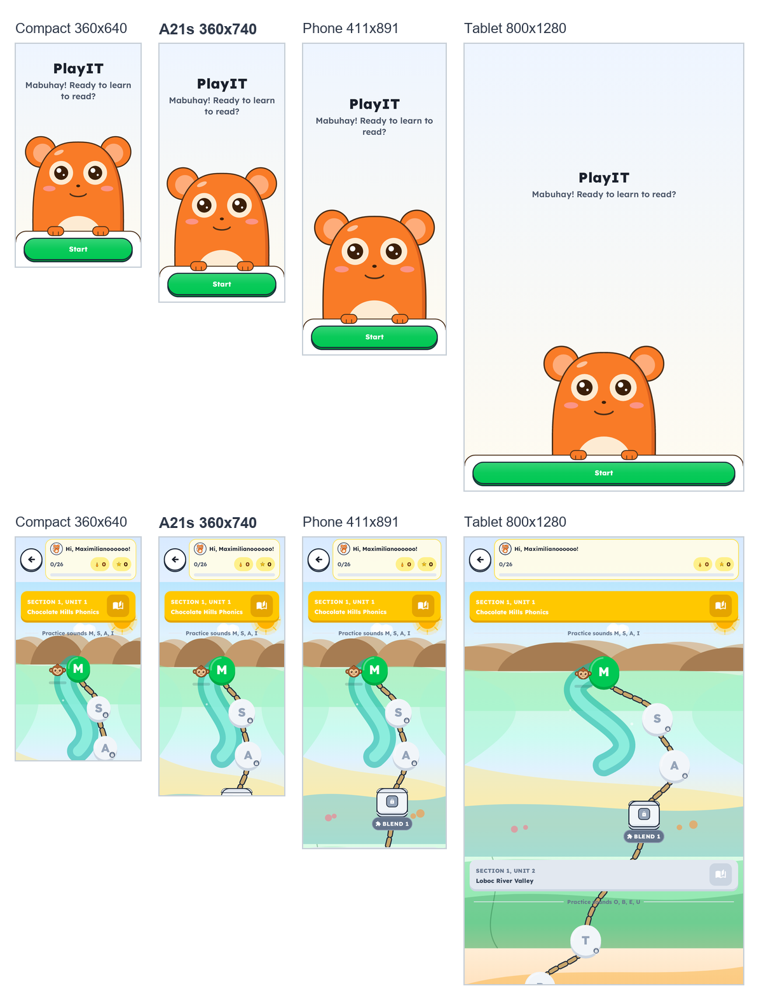
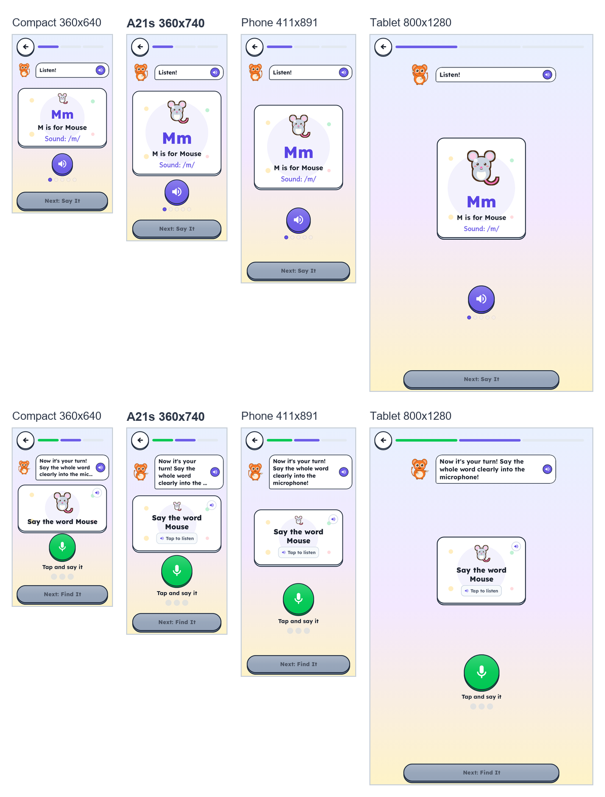
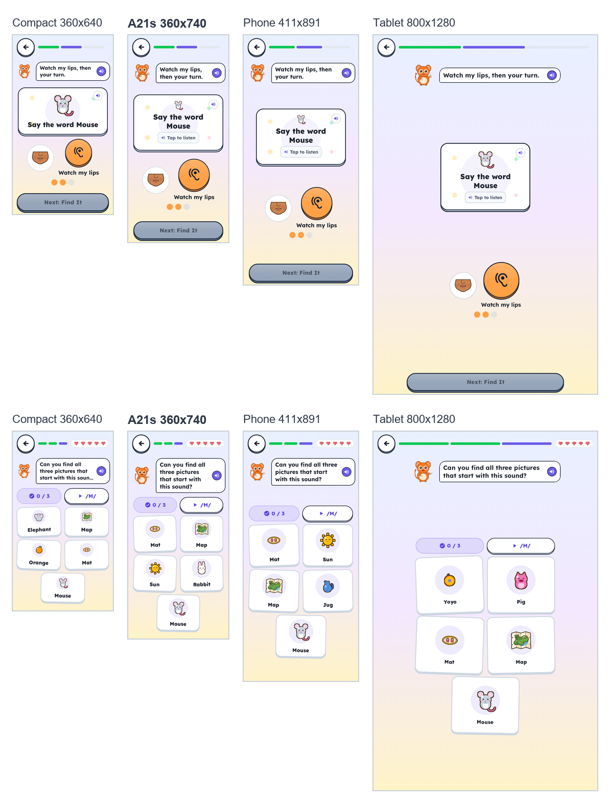
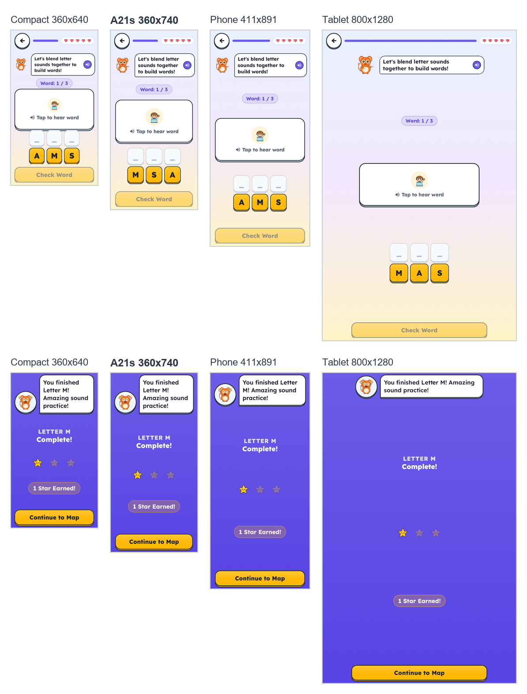

# Software Test Document (STD)
## Project: PlayIT — An Offline-First Gamified Early Literacy Mobile Application
**Course:** IT411 (Section G7) — Capstone & Research 2 | Semester 1, AY 2026–2027  
**Degree Program:** Bachelor of Science in Information Technology  
**Department:** College of Computer Studies, Cebu Institute of Technology – University  
**Document Version:** 1.0 (test record of debug APK H, commit `0320385`)  
**Publication Date:** October 14, 2026  
**Document Status:** Submitted for Adviser Review and Evaluation  
**Prepared by:** Group 56 — PlayIT Capstone Team: Riva, Zendrix (Team Lead); Palis, John James; Miel, Kaysean; Durano, Ashlee Skye; Bien, Erik Samuel  
**Adviser:** Mr. Joemarie C. Amparo  

---

## Document Revision History

| Version | Date | Primary Author(s) | Description |
|:---:|:---:|:---:|---|
| **1.0** | October 14, 2026 | Capstone Team | First issue. Specifies the test cases for SRS v3.0 rev. 3.8, records a clean run of the whole automated suite on the code of debug APK H (433 test cases: 427 passed, 6 skipped by design, 0 failed), the 4-size layout matrix, two inspections of the build, and the incidents found in testing. It reports two open defects found while writing it (DEF-01, DEF-02). The tables of results are generated from the raw JUnit logs by `tools/docs/build_std.py`, which stops if a cited test is missing or did not pass. |

---

## 1. Introduction

### 1.1 Purpose
This Software Test Document records how the refactored PlayIT was tested against its requirements, and what the tests showed. It follows the chain the course asks for:

**Updated SRS (v3.0 rev. 3.8) → System Features (the six modules) → Test Cases (§4) → Test Execution (§5, §6) → Test Results (§5 to §8)**

For every test case it states the input, the expected result taken from the SRS, the actual result observed, and the evidence (the test methods that ran, or the inspection output). A test case is marked **Pass** only when every piece of its evidence passed in the recorded run. Where the build does not meet a requirement, the test case is marked **Fail** and the defect is reported in §7, not left out. Where a test case could not run on this build (a planned feature, a field measure, or a device timing), it is listed in §4.8 with the reason and the date it is scheduled.

The structure follows ISO/IEC/IEEE 29119-3:2021 (test documentation), condensed for one build: test plan (§2), test case specifications (§4), execution log (§5, Appendix A), incident report (§7) and test completion report (§8).

### 1.2 Test Item and Scope
- **Test item:** PlayIT debug APK H, `playit-debug-H-0320385.apk` (SHA-256 `d301007f…937d`), built from branch `refactor/hear-say-it` at commit `0320385`. This is the build submitted with the SDD v2.0 rev. 2.8, SRS v3.0 rev. 3.8 and SPMP v2.0 rev. 2.6.
- **In scope:** all automated unit, component and layout tests in `app/src/test/`; the 4-size layout matrix; an inspection of the APK's permissions; an integrity check of every released audio clip; and the phone tests the team ran on earlier builds, which found the incidents in §7.1.
- **Out of scope for this run** (each listed in §4.8): Round 2 field validation with learners and teachers (Weeks 7–8), the Gate 3 teacher audit of audio, timing measured on the device, and the features the SDD §2.0 lists as planned (telemetry and CSV export, spaced recall, session pacing, the voice-driven mic ripple).

### 1.3 References
1. PlayIT Software Requirements Specification (SRS v3.0, rev. 3.8), October 14, 2026: requirement IDs and the RTM test case IDs (§4).
2. PlayIT Software Design Description (SDD v2.0, rev. 2.8), October 14, 2026: §2.0 implementation status, §6 verification plan.
3. PlayIT Software Project Management Plan (SPMP v2.0, rev. 2.6): WBS 7 (Verification and STD), Milestones 6 and 7.
4. PlayIT MVP Validation Findings and Refactoring Priorities (course form), October 14, 2026.
5. ISO/IEC/IEEE 29119-3:2021, *Software and systems engineering — Software testing — Part 3: Test documentation*.
6. IEEE Std 829-2008, *IEEE Standard for Software and System Test Documentation* (superseded by 29119-3; used for the incident report fields).

### 1.4 Definitions
| Term | Meaning in this document |
|---|---|
| **Test case (TC)** | One check of one requirement behaviour, with input, expected result, actual result and status. IDs follow the SRS RTM families (TC-AUD, TC-MIC, TC-ASR, TC-BLD, TC-ACC, TC-IND, TC-DB, TC-TEL, TC-EXP, TC-REV, TC-PERF, TC-SCR) and add TC-SAY, TC-FND, TC-PRG, TC-PZ, TC-SEC and TC-POL for behaviours the RTM groups together. |
| **Test method** | One JUnit test in `app/src/test/`; a test case cites one or more. |
| **Pass / Fail / Skip** | As recorded by JUnit. A skip is allowed only for the 6 font-scale checks on the 360x640 profile (§5.3). |
| **Not run** | The test case is specified but could not run on this build; §4.8 gives the reason. |
| **Robolectric** | Runs Android code, including Jetpack Compose screens, on the JVM, so screens can be tested without a phone. |
| **Roborazzi** | Captures the screens rendered by Robolectric as images (§6). |
| **Unclipped bounds** | A component's full position, even if it is scrolled or pushed out of view; the layout checks use it so that content off screen fails. |
| **Foil** | A wrong answer that sounds close to the right one: the letter's name ("em" for /m/), an added vowel ("muh"), or a substituted sound ("pa" for /f/). |
| **dp / sp** | Density-independent pixels (size) and scaled pixels (text). |

---

## 2. Test Approach

### 2.1 Test Levels
| Level | What it exercises | How it runs | Where reported |
|---|---|---|---|
| **L1 Unit** | Pure rules in `domain/`: hearts, stars, unlock, streak, grid, speech judge, prompt ladder, word bank | JUnit 4 on the JVM | §4, §5 |
| **L2 Component** | ViewModels with mocked repositories, audio and recognizer (MockK, coroutine test clock); Room DAO on an in-memory database | JUnit 4, Robolectric, kotlinx-coroutines-test | §4, §5 |
| **L3 UI and layout** | Compose screens on 4 screen profiles and at font scale 1.3; screen captures | Robolectric, Compose UI test, Roborazzi | §6 |
| **L4 Inspection** | The built APK's permissions; the released audio against the app's files; source policies (no emoji, no haptics) | `aapt dump`, `tools/docs/check_audio_release.py`, policy tests | §5.4 |
| **L5 Device (manual)** | The app on a Samsung Galaxy A21s, played as a child would | Team phone tests of APK B, D and E; APK H acceptance before submission | §5.5, §7.1 |
| **L6 Field** | Learners, parents and teachers (Round 2) | SPMP Milestones 5–6, Weeks 7–8 | §4.8 (not run) |

### 2.2 Test Design Techniques
| Technique | Where it is used |
|---|---|
| **Equivalence partitioning** | Say It answers split into classes: the key word, the letter's name, an added vowel, a substitution, another word, a partial word, silence (TC-ASR-07 to TC-ASR-10). |
| **Boundary values** | Hearts 5 → 0 and the 3-heart restart; recovery at the pool's cap; 6 profiles; a 16-character learner name; idle at 9 s and 10.001 s; the smallest screen, 360x640 (TC-FND-05 to 07, TC-PRF-01, TC-IND-01, §6). |
| **State transition** | The four mic states and the prompt ladder from the first to the third miss (TC-MIC-03, TC-SAY-01 to 05). |
| **Decision table** | Star rules by hearts lost (TC-PRG-01, TC-PRG-02). |
| **Error guessing** | Rapid repeated taps, the recognizer stopped by the system, a tile deal that is already solved, a stale picture after "next letter" (TC-ASR-11, TC-ASR-12, TC-BLD-02, INC-04). |
| **Negative tests** | Unknown lesson IDs, blank or too-long names, wrong and non-numeric answers at the parent gate (TC-FND-08, TC-PRF-02, TC-PZ-01). |

### 2.3 Beyond the Happy Path
| Failure mode | Test cases |
|---|---|
| **Invalid inputs** | TC-ASR-07 (letter names, added vowels, substitutions rejected with their error type), TC-ASR-08 (partial, misspelled and other words rejected), TC-FND-08 (unknown lesson ID), TC-PRF-02 (blank or 17-character name ignored), TC-PZ-01 (wrong and non-numeric gate answers) |
| **Boundary conditions** | TC-FND-05 (hearts reach 0), TC-FND-06 (restart with 3 hearts, losses kept), TC-FND-07 (recovery capped at the starting pool), TC-BLD-05, TC-PRF-01 (6th profile), TC-PRG-01 (star thresholds), §6 (smallest screen, font scale 1.3, 16-character name) |
| **Missing inputs and timeouts** | TC-ASR-09 (blank transcript), TC-ASR-10 (no final result: judged at the 3.8 s timeout), TC-IND-01 (10 s without a touch), TC-ASR-11 (recognizer stopped by the system) |
| **Incorrect user actions** | TC-BLD-02 (tiles never dealt solved), TC-BLD-03 (wrong word: one heart, a soft sound, no buzz), TC-BLD-04 (hint after two mistakes), TC-ASR-12 (rapid taps), TC-SAY-04 (tapping the mic after the third miss does nothing) |
| **Unauthorized access and data leaving the device** | TC-PZ-01 (parent gate), TC-SEC-01 (no INTERNET permission in the APK), TC-SEC-02 (cloud backup of the database disabled) |

### 2.4 Pass/Fail, Entry and Exit Criteria
- **Entry:** the code compiles; the run starts from clean results (`cleanTestDebugUnitTest`), so no result is reused from an earlier run.
- **A test case passes** when every cited test method passed in the recorded run, or the inspection output equals the expected result. The generator of this document refuses to build if a cited test is missing from the run, failed, or was skipped outside the allowed font-scale checks.
- **A test case fails** when the build does not do what the SRS requires, even if no automated test fails. Such a failure is reported as a defect in §7.2.
- **Exit criteria for the submission:** 0 failed automated tests; every failing test case linked to a defect with a severity and an owner; every test case that did not run listed with its reason and schedule.

### 2.5 Test Environment
- **Automated runs:** the team's Windows 11 development laptop; OpenJDK 17.0.16 (Eclipse Temurin), Gradle 8.9, Android Gradle Plugin 8.4.0, Kotlin 1.9.23, JUnit 4.13.2, Robolectric 4.13 emulating Android SDK 34, Roborazzi 1.26.0, MockK 1.13.10. The app is offline, so no network service is involved.
- **Screen profiles (Robolectric qualifiers):** Compact `w360dp-h640dp-xhdpi`; A21s `w360dp-h740dp-xhdpi` (the team's test phone); Phone `w411dp-h891dp-xxhdpi`; Tablet `w800dp-h1280dp-mdpi`.
- **Device:** Samsung Galaxy A21s (the team's test phone), for the manual tests in §5.5.
- **Test data:** the seeded curriculum (26 letters, 7 chapters, 33 Blend It words); fakes and mocks inside each test; no learner data.

---

## 3. Traceability: SRS → Features → Test Cases → Results

| Requirement (SRS rev. 3.8) | System feature | Test cases (§4) | Result on APK H |
|---|---|---|---|
| **FR-01** Carrier narration | Hear It | TC-HI-01, TC-IND-02 | Pass |
| **FR-02** Pure phoneme model and sequence | Hear It | TC-HI-01 to TC-HI-05; TC-AUD-01, TC-AUD-02, TC-SCR-01 | Pass; not run: device timing, teacher audit |
| **FR-03** Tutoring loop, mic states, prompt ladder | Say It | TC-MIC-03, TC-SAY-01 to TC-SAY-06, TC-ASR-09 to TC-ASR-12; TC-MIC-01, TC-MIC-02 | Pass; not run: device timing, planned ripple |
| **FR-NEW-REC** Spaced recall | Say It | TC-REV-01 to TC-REV-03 | Not run: planned (`LearnerModel`) |
| **FR-04** Find It grid | Find It | TC-FND-01, TC-FND-02, TC-FND-09, TC-AUD-04; TC-FND-03 | Pass; **Fail: TC-FND-03 (DEF-01)** |
| **FR-05** Hearts in Find It | Find It | TC-FND-04 to TC-FND-06, TC-FND-08 | Pass |
| **FR-07** Heart recovery | Find It | TC-FND-07 | Pass |
| **FR-13** Decodable Blend It words | Blend It | TC-BLD-01 to TC-BLD-07 | Pass |
| **FR-06** Star rules | Progression | TC-PRG-01; TC-PRG-02 | Pass; **Fail: TC-PRG-02 (DEF-02)** |
| **FR-08** Linear unlock | Progression | TC-PRG-03 | Pass |
| **FR-09** Daily streak | Progression | TC-PRG-04 | Pass |
| **FR-14** Multi-profile | Profiles | TC-PRF-01 to TC-PRF-03; TC-DB-03 | Pass; partial: TC-DB-03 |
| **FR-10** Parent dashboard and gate | Parent Zone | TC-PZ-01, TC-PZ-04 | Pass |
| **FR-12** PDF report | Parent Zone | TC-PZ-02 | Pass |
| **FR-NEW-TEL** Telemetry and CSV export | Parent Zone | TC-TEL-01, TC-EXP-01, TC-EXP-02 | Not run: planned (Room schema v4) |
| **NFR-AUD-01** Audio release gate | Audio | TC-AUD-03, TC-HI-03, TC-BLD-06, TC-PZ-03; TC-AUD-02 | Pass; Gate 3 teacher audit pending |
| **NFR-ASR-01** Judge accuracy and error types | Say It | TC-ASR-07, TC-ASR-08, TC-ASR-13; TC-ASR-01 to TC-ASR-06 | Pass; not run: Round 2 agreement and false rejects |
| **NFR-PERF-01** Latency | All | TC-PERF-01, TC-PERF-02 | Not run: needs telemetry on the device |
| **NFR-IND-01** Independent use, idle re-prompt | All lessons | TC-IND-01, TC-IND-02, TC-PRF-03; TC-IND-03 | Pass; not run: Round 2 |
| **NFR-ACC-01** Mouth-shape cues | Say It | TC-ACC-01, TC-ACC-03, TC-SAY-03 | Pass |
| **NFR-ACC-02** 64 dp targets, layout | All screens | TC-ACC-02, TC-ACC-04, TC-POL-03, layout matrix (§6) | Pass |
| **NFR-SES-01** Session pacing | All | TC-SES-01 | Not run: [Planned — Round 2], not built |
| **NFR-REL-01** Offline persistence | Data | TC-DB-01, TC-DB-02 | Not run: needs schema v4 and the device |
| **NFR-SEC-01** Local data only | Build | TC-SEC-01, TC-SEC-02 | Pass |
| Team policies (zero emoji, no haptics) | All screens | TC-POL-01, TC-POL-02 | Pass |

---

## 4. Test Case Specifications and Results

Each table gives the input, the expected result (from the SRS), the actual result observed in the run, the evidence and the status. Evidence and status come from the JUnit logs (§5).

### 4.1 Module 1: Letter-Sound Acquisition (Hear It)

| TC ID | Req. | Type | Input / steps | Expected result | Actual result | Evidence | Status |
|---|:---:|---|---|---|---|---|---|
| **TC-HI-01** | FR-02.4, FR-01 | Functional | Build the modeling sequence for M (key word "mouse") | Starts with the carrier "Listen!"; the sound 3 times with 500 ms pauses before the key word; the key word; the sound once more; ends on the sound, never "Say it with me!" | First clip `car_listen.wav`; 3 sounds before the key word, 1 after; 2 pauses of 500 ms; the last two clips are the key word and the sound; no "say it with me" clip. Loading a letter plays the whole sequence, then the next cue | `HearItSequenceBuilderTest.​build_​m_​mouse_​followsTable3`<br>`HearItViewModelTest.​load_​playsFullModelingSequence`<br>`HearItViewModelTest.​firstSequenceEnd_​playsNextCue_​andHighlights` | **PASS** (3 of 3 runs) |
| **TC-HI-02** | FR-02.6 | Functional | Tap replay | Replays steps 3–6 ("This letter says…" to the sound), not the opening carrier | Replay starts at `car_this_letter_says` and ends on the sound; no "Listen!", no "say it with me" | `HearItSequenceBuilderTest.​replayTemplate_​isSteps3to6`<br>`HearItViewModelTest.​playPhonemeSound_​playsReplaySegment`<br>`HearItViewModelTest.​replayEnd_​alsoUnlocks` | **PASS** (3 of 3 runs) |
| **TC-HI-03** | FR-02.1–3, NFR-AUD-01 | Functional | Resolve the sound for M, S, I and the other letters | M, S and I play their released clips (`ph_m.wav`, `ph_s.wav`, `ph_i.wav`), stored apart from carriers and words; the files exist and are not empty | Paths resolve to the released WAV files, which exist with content; letters not yet remade keep the MVP clip | `AudioResolverTest.​phonemeM_​usesReleasedHeldSound`<br>`AudioResolverTest.​phonemeS_​usesReleasedHeldSound`<br>`AudioResolverTest.​phonemeI_​usesReleasedClip`<br>`AudioResolverTest.​releasedPhoneme_​fileExists`<br>`AudioResolverTest.​otherPhonemes_​keepOldPath` | **PASS** (5 of 5 runs) |
| **TC-HI-04** | FR-02 | UI | Hear It while the sound plays | One message at a time: Lily says "Listen!", the card shows the sound once, the play button keeps its colour | "Sound: /m/" appears once, the bubble says "Listen!", and the play button keeps its colour | `HearItScreenFocusTest.​whilePlaying_​soundTextShowsOnce_​andLilySaysListen`<br>`HearItScreenFocusTest.​whilePlaying_​playButtonKeepsItsColour` | **PASS** (2 of 2 runs) |
| **TC-HI-05** | FR-02 | Negative | Open Hear It with an unknown or missing letter ID | No crash: an unknown ID sets a load error; a missing ID falls back to letter 1 | Load error set for an unknown ID; a missing ID loads letter 1 | `HearItViewModelTest.​loadPhoneme_​invalidId_​setsLoadError`<br>`HearItViewModelTest.​loadPhoneme_​nullId_​defaultsToId1` | **PASS** (2 of 2 runs) |

### 4.2 Module 2: Speech Production and Tutoring (Say It)

| TC ID | Req. | Type | Input / steps | Expected result | Actual result | Evidence | Status |
|---|:---:|---|---|---|---|---|---|
| **TC-MIC-03** | FR-03.2 | State transition | Map each Say It state to the mic | Four distinct states, none red: Idle, Listening, Heard (speech detected), Result (correct or try again); after the third miss the mic rests | Idle → IDLE; listening without speech → LISTENING; with speech → HEARD; correct → RESULT_CORRECT; wrong → RESULT_TRY_AGAIN; after the third miss → DONE | `MicStatusTest` (all 6) | **PASS** (6 of 6 runs) |
| **TC-SAY-01** | FR-03.4 | State transition | First miss: the child says the letter's name ("em") | Spoken correction for the error type: "That's the letter's name. Its sound is /m/", re-model, "Your turn" | Plays the soft sound, `fb_letter_name`, `fb_its_sound_is`, the sound, the word and `car_your_turn`; tutor action is a level-1 correction of type LETTER_NAME; Next stays locked | `SayItViewModelTest.​firstLetterNameMiss_​playsLetterNameCorrection`<br>`TutorPolicyTest.​firstMiss_​correctsAtLevel1_​withErrorType` | **PASS** (2 of 2 runs) |
| **TC-SAY-02** | FR-03.4 | State transition | First miss: an added vowel ("ma"); or another word | Added vowel: "Almost! Just /m/, no 'ah'" with a re-model; another word: "Listen" and a re-model | The added-vowel correction (`fb_no_ah`) plays; another word gets the "Listen" re-model | `SayItViewModelTest.​addedVowelError_​triggersFbNoAhSpokenCorrection`<br>`SayItViewModelTest.​otherWordMiss_​playsListenRemodel` | **PASS** (2 of 2 runs) |
| **TC-SAY-03** | FR-03.4, NFR-ACC-01 | State transition | Second miss | Slower re-model with the mouth-shape cue | No cue after the first miss; the cue shows after the second, with "Watch my lips"; level-2 correction | `SayItViewModelTest.​secondMiss_​showsMouthCue`<br>`SayItViewModelTest.​secondMiss_​playsWatchMyLips`<br>`TutorPolicyTest.​secondMiss_​correctsAtLevel2` | **PASS** (3 of 3 runs) |
| **TC-SAY-04** | FR-03.4 | State transition, negative | Third miss, then tap the mic again | Together-practice ("Let's say it together"), the lesson moves on without a failure screen, the miss is saved; the mic does not reopen | Plays `car_lets_say_together`, the word, `fb_try_later`; Next unlocks; 3 incorrect attempts saved; the mic shows DONE; a later tap does not start the recognizer | `SayItViewModelTest.​thirdMiss_​emitsLeadAndMoveOn_​andSavesIncorrect`<br>`SayItViewModelTest.​thirdMiss_​micRestsAndNextUnlocks`<br>`SayItViewModelTest.​afterLeadAndMoveOn_​startListeningIsIgnored`<br>`TutorPolicyTest.​thirdMiss_​leadsAndMovesOn` | **PASS** (4 of 4 runs) |
| **TC-SAY-05** | FR-03.5 | Boundary | Wrong answers, including three in a row | Say It never removes a heart | Hearts after a wrong answer and after the third miss equal the hearts before | `SayItViewModelTest.​evaluateSpeech_​incorrectTranscript_​doesNotDeductHeart`<br>`SayItViewModelTest.​thirdMiss_​emitsLeadAndMoveOn_​andSavesIncorrect` | **PASS** (2 of 2 runs) |
| **TC-SAY-06** | FR-03 | Functional | Say the key word, first try or after a miss | Praise ("Yes!") and Next unlocks | State Correct; praise action; Next available after a miss too | `SayItViewModelTest.​evaluateSpeech_​correctTranscript_​setsCorrectState`<br>`SayItViewModelTest.​correctAfterMiss_​praises_​andCanContinue`<br>`TutorPolicyTest.​correct_​anyAttempt_​praises` | **PASS** (3 of 3 runs) |
| **TC-ASR-07** | NFR-ASR-01.4 | Invalid input | Foils: "em", "es", "bee", "zee", "ay", "m"; "ma", "muh", "sa", "buh"; "pa" for /f/, "ba" for /v/, "sa" for /z/ | Every foil is rejected and labelled LETTER_NAME, ADDED_VOWEL or SUBSTITUTION | All 13 foils rejected with the expected error type; the ViewModel shows the matching state | `SpeechValidatorTest.​judgeSound_​letterName_​rejected`<br>`SpeechValidatorTest.​judgeSound_​addedVowel_​rejected`<br>`SpeechValidatorTest.​judgeSound_​substitution_​rejected`<br>`SayItViewModelTest.​evaluateSpeech_​letterName_​setsIncorrectWithLetterName`<br>`SayItViewModelTest.​evaluateSpeech_​addedVowel_​setsIncorrectWithAddedVowel` | **PASS** (5 of 5 runs) |
| **TC-ASR-08** | FR-03.6 | Invalid input, equivalence | Word mode: the 26 key words; and "m", "muh", "mmm", "mous", "elphant", "sunny", "sub" for "sun", "box" for "fox" | Each key word is accepted (any case or spacing); letter sounds, partial or misspelled words and other words are rejected | 26 of 26 key words accepted; all wrong forms rejected; the grammar holds the word and its foils, not generic decoys | `SpeechValidatorTest.​wordExactMatch_​returnsTrue_​forAll26ExampleWords`<br>`SpeechValidatorTest.​wordMode_​caseAndWhitespaceInsensitive`<br>`SpeechValidatorTest.​wordMode_​rejectsLetterSoundOnly`<br>`SpeechValidatorTest.​wordMode_​rejectsPartialOrMisspelledWords`<br>`SpeechValidatorTest.​wordMode_​rejectsOtherWordsAndMinimalPairs`<br>`SpeechValidatorTest.​grammarFor_​wordMode_​hasFoilsNotGenericDecoys` | **PASS** (6 of 6 runs) |
| **TC-ASR-09** | FR-03.4 | Missing input | Null, empty or blank transcript | Not accepted (counts as a miss) | Rejected in both letter and word mode | `SpeechValidatorTest.​nullOrBlankText_​returnsFalse`<br>`SpeechValidatorTest.​wordMode_​nullOrBlankTranscript_​returnsFalse` | **PASS** (2 of 2 runs) |
| **TC-ASR-10** | FR-03.4 | Timeout | A wrong partial result ("em", "ma") with no final result | A partial does not end the attempt (it may be the start of the word); without a final result the attempt is judged at the timeout | After wrong partials the mic keeps listening and nothing is scored; at the 3.8 s auto-stop "ma" is judged ADDED_VOWEL; a partial followed by the right word is correct | `SayItViewModelTest.​onResult_​partialFoil_​keepsListening`<br>`SayItViewModelTest.​onResult_​partialAddedVowelThenTimeout_​setsIncorrectWithAddedVowel`<br>`SayItViewModelTest.​onResult_​partialAddedVowelThenFinalWord_​isCorrect`<br>`SayItViewModelTest.​onResult_​partialLetterNameThenFinalWord_​isCorrect` | **PASS** (4 of 4 runs) |
| **TC-ASR-11** | FR-03 | Error guessing | The system stops the recognizer while listening (app sent to the background) | Return to Idle; the dropped attempt is not scored | Mic IDLE, state Idle, no attempt recorded, and the cancelled timeout does not judge it later | `SayItViewModelTest.​recognizerStoppedExternally_​returnsToIdle` | **PASS** (1 of 1 runs) |
| **TC-ASR-12** | FR-03 | Incorrect action | Tap "hear the word" three times quickly | The word plays once | One playback | `SayItViewModelTest.​playWordAudio_​rapidTaps_​debounced` | **PASS** (1 of 1 runs) |
| **TC-ASR-13** | FR-03.6 | Configuration | Default scoring mode | Pure-sound scoring is off (the Vosk spike could not confirm a pure sound); a held sound alone is never accepted while off | Sound mode off by default; a sustained sound is "unconfirmed"; the sound-mode grammar accepts nothing | `SpeechValidatorTest.​soundMode_​isOffByDefault`<br>`SpeechValidatorTest.​judgeSound_​soundModeOff_​sustainedIsUnconfirmed`<br>`SpeechValidatorTest.​grammarFor_​soundMode_​hasNoAcceptedTokens` | **PASS** (3 of 3 runs) |

### 4.3 Module 3: Phoneme Discrimination (Find It)

| TC ID | Req. | Type | Input / steps | Expected result | Actual result | Evidence | Status |
|---|:---:|---|---|---|---|---|---|
| **TC-FND-01** | FR-04 | Functional | Open Find It for M | 5 cards: exactly 3 targets and 2 distractors | 5 cards, 3 correct and 2 distractors | `GridGeneratorTest.​generate5ItemGrid_​returnsExactly5ItemsWith3CorrectAnd2Distractors`<br>`FindItViewModelTest.​loadGrid_​validId_​loadsTargetAnd5ItemGrid` | **PASS** (2 of 2 runs) |
| **TC-FND-02** | FR-04 | Functional | Generate 200 grids for every letter | No distractor starts with the target's sound (c, k and q count as one sound); no distractor from the x, ng or ñ banks | 0 violations | `GridGeneratorTest.​distractors_​neverShareTheTargetSound`<br>`GridGeneratorTest.​distractorLettersFor_​k_​excludesSameSoundGroup`<br>`GridGeneratorTest.​distractors_​neverFromSpecialBanks` | **PASS** (3 of 3 runs) |
| **TC-FND-03** | FR-04 | Functional | Open Find It for letter 1 (M) and letter 2 (S) on a new profile | Distractors come "strictly from previously mastered letters" (SRS FR-04; `01_REQUIREMENTS_SUMMARY.md`) | **Not met.** `generate5ItemGrid` ignores the list of letters it is given and draws distractors from every curriculum letter. The captures in Figure 3 show M with Elephant, Orange, Rabbit, Sun, Jug, Yoyo and Pig, none of them taught yet. No test covers this rule. | Code inspection: `GridGenerator.kt` lines 62–98; `FindItViewModel.kt` line 123; Figure 3 | **FAIL (DEF-01)** |
| **TC-FND-04** | FR-05 | Functional | Tap a distractor | Exactly 1 heart lost, a gentle sound, the miss saved | Hearts 5 → 4; state Incorrect; attempt saved as incorrect | `FindItViewModelTest.​selectPictureItem_​incorrectItem_​deductsHeart`<br>`HeartManagerTest.​deductHeart_​decrementsCountAndIncrementsHeartsLost` | **PASS** (2 of 2 runs) |
| **TC-FND-05** | FR-05 | Boundary | 5 wrong taps; then one more deduction | At 0 hearts the activity stops (game over); hearts never go below 0 | Hearts 0, state GameOver; a further deduction keeps 0 | `FindItViewModelTest.​selectPictureItem_​allHeartsLost_​setsGameOver`<br>`HeartManagerTest.​deductHeart_​signalsGameOverWhenZero` | **PASS** (2 of 2 runs) |
| **TC-FND-06** | FR-05 | Boundary | Restart after depletion | Reload with a 3-heart buffer; the hearts lost before the restart still count for stars | Hearts 3, found count 0, not game over; the session's hearts lost survive the restart | `FindItViewModelTest.​restartSession_​resetsHeartsAndState`<br>`HeartManagerTest.​restartAtReducedPoolOnDepletion`<br>`FindItViewModelTest.​sessionHeartsLost_​survivesRestart`<br>`HeartManagerTest.​sessionHeartsLost_​survivesRestart`<br>`FindItViewModelTest.​wrongTaps_​countIntoSessionHeartsLost` | **PASS** (5 of 5 runs) |
| **TC-FND-07** | FR-07 | Boundary | 1 wrong tap, then 3 right taps in a row; and 3 right taps at a full pool of 3 | +1 heart per 3 in a row, never above the session's starting pool | Hearts 4 → 5 after three in a row; a full pool of 3 stays 3 | `FindItViewModelTest.​threeCorrectInARow_​recoversAHeart`<br>`HeartManagerTest.​checkRecovery_​addsHeartEveryThreeConsecutiveCorrect`<br>`HeartManagerTest.​recoveryCapsAtStartingPool_​recommendedRule` | **PASS** (3 of 3 runs) |
| **TC-FND-08** | FR-05 | Negative | Open Find It, Say It or Letter Complete with an unknown letter ID (999) | No crash; a load error is shown | Target null and load error set; same in Say It and Letter Complete | `FindItViewModelTest.​loadGrid_​invalidId_​setsLoadError`<br>`SayItViewModelTest.​loadPhoneme_​invalidId_​setsLoadError`<br>`LetterCompleteViewModelTest.​completeLesson_​handlesMissingPhoneme_​andSetsLoadError` | **PASS** (3 of 3 runs) |
| **TC-FND-09** | FR-04 | Functional | Find all 3 targets | The lesson completes and the next cue plays | Found count 3, lesson complete, next cue appended | `FindItViewModelTest.​selectPictureItem_​correctItem_​incrementsFoundCount`<br>`FindItViewModelTest.​selectPictureItem_​allThreeCorrect_​completesLesson`<br>`FindItViewModelTest.​completion_​appendsNextCue` | **PASS** (3 of 3 runs) |

### 4.4 Module 4: Word Construction (Blend It)

| TC ID | Req. | Type | Input / steps | Expected result | Actual result | Evidence | Status |
|---|:---:|---|---|---|---|---|---|
| **TC-BLD-01** | FR-13.1–2 | Data validation | Check every seeded word against the letters taught by its group | 100% decodable with the letters taught so far; AIM, BEE, TOY, BOY, ZOO gone; AM, SUM, TUB, YAM, ZIP present in the same slots; QUIZ the one documented exception | 33 words (3 in group 1, then 5 per group); 0 untaught letters except QUIZ; the 5 old words absent and the 5 new ones present | `BlendItWordSeedsTest.​everyWordUsesOnlyTaughtLetters`<br>`BlendItWordSeedsTest.​nonDecodableWordsAreGone`<br>`BlendItWordSeedsTest.​replacementsKeepTheirSlots`<br>`BlendItWordSeedsTest.​thirtyThreeWords_​threeThenFivePerGroup`<br>`BlendItWordSelectorTest` (all 2) | **PASS** (6 of 6 runs) |
| **TC-BLD-02** | FR-13.3 | Incorrect action | Deal the tiles 200 times for SAM, SIS, AM, TUB, YAM, ZIP, QUIZ, MOM | Never dealt in the answer's order; always the same letters | 1,600 deals, none solved, none with a letter lost or added; a word with one possible order (MM) keeps it | `BlendItTileDealTest` (all 2) | **PASS** (2 of 2 runs) |
| **TC-BLD-03** | FR-13, FR-05 | Incorrect action | Submit M-A-S for SAM | One heart lost; a soft "not yet" sound, never a buzz; the miss saved | Hearts −1; 1 wrong attempt; state WordIncorrect; the pop plays and the buzz does not | `BlendItViewModelTest.​submitWord_​incorrectWord_​deductsHeart`<br>`BlendItViewModelTest.​wrongSubmit_​playsSoftPop_​notBuzz` | **PASS** (2 of 2 runs) |
| **TC-BLD-04** | FR-13 | Incorrect action | Two wrong submissions, then the hint | The first letter is locked in place | 1 locked hint; the first placed tile is S | `BlendItViewModelTest.​applyHint_​afterTwoMistakes_​locksCorrectCharacter` | **PASS** (1 of 1 runs) |
| **TC-BLD-05** | FR-13, FR-05 | Boundary | 5 wrong submissions, then restart | At 0 hearts the depleted state shows; the restart gives 3 hearts and keeps the 5 lost for stars | Hearts 0 → HeartDepleted → restart: 3 hearts, word 1, Idle; result reports 5 hearts lost | `BlendItViewModelTest.​heartDepleted_​restartsWithThreeHearts` | **PASS** (1 of 1 runs) |
| **TC-BLD-06** | FR-13, NFR-AUD-01 | Functional | Resolve the AM, TUB and YAM word clips | The released WAV clips (audio release `2026-10-11-words`) exist and are used | The three WAV files exist with content; the seeds point at them | `AudioResolverTest.​releasedWords_​filesExist`<br>`AudioResolverTest.​releasedWords_​useWav`<br>`BlendItWordSeedsTest.​releasedWordsPointAtTheirWav` | **PASS** (3 of 3 runs) |
| **TC-BLD-07** | FR-13 | Functional | A correct word | Each tile's sound plays in turn before the whole word; the next word follows | Every tile lights and sounds before the word; the word advances | `BlendItViewModelTest.​soundOut_​waitsForEachSound`<br>`BlendItViewModelTest.​soundOut_​lightsAllTilesBeforeWord`<br>`BlendItViewModelTest.​submitWord_​correctWord_​transitionsToWordCorrectAndAdvances` | **PASS** (3 of 3 runs) |

### 4.5 Module 5: Progression, Gamification and Profiles

| TC ID | Req. | Type | Input / steps | Expected result | Actual result | Evidence | Status |
|---|:---:|---|---|---|---|---|---|
| **TC-PRG-01** | FR-06 | Decision table | Finish a letter with 0, 1, 2, 3 and 4 hearts lost; carry the count through navigation | 0 lost: 3 stars; 1–2 lost: 2 stars; 3 or more: 1 star; the count reaches Letter Complete; 1 star says "You finished", not "mastered" | 0 → 3, 1 → 2, 2 → 2, 3 → 1, 4 → 1; the route carries the count; the 1-star message is "You finished Letter M!" | `StarCalculatorTest` (all 3)<br>`LetterCompleteViewModelTest.​completeLesson_​calculates3StarsFor0HeartsLost_​andSavesProgress`<br>`LetterCompleteViewModelTest.​completeLesson_​calculates2StarsFor1HeartLost`<br>`LetterCompleteViewModelTest.​heartsLostArg_​threeOrMore_​givesOneStar`<br>`RoutesTest.​letterComplete_​carriesHeartsLost`<br>`LetterCompleteMessageTest` (all 2) | **PASS** (9 of 9 runs) |
| **TC-PRG-02** | FR-06 | Decision table | Find It with 1 wrong tap (3 correct of 4 taps = 75% accuracy) | SRS FR-06: 2 stars need at least 80% accuracy, so 75% gives 1 star | **Not met.** Letter Complete passes only hearts lost to `StarCalculator`, whose accuracy defaults to 100%, so this case gets 2 stars; a test (`completeLesson_calculates2StarsFor1HeartLost`) expects 2. With 3 targets, 1 wrong tap is always 75%, so the SRS rule as written never gives 2 stars in Find It. | Code inspection: `LetterCompleteViewModel.kt` line 102, `StarCalculator.kt` | **FAIL (DEF-02)** |
| **TC-PRG-03** | FR-08 | Functional | Letter 2 with letter 1 incomplete, then complete | Letter N+1 stays locked until letter N is complete; Blend It opens when its group is complete | Locked, then unlocked; group and Blend It unlock follow the same rule | `UnlockManagerTest` (all 3)<br>`GroupUnlockManagerTest` (all 4)<br>`MapTapRulesTest.​lockedNode_​staysLocked` | **PASS** (8 of 8 runs) |
| **TC-PRG-04** | FR-09 | Boundary | Activity on the first day, the same day, the next day, after 50 hours | First activity: streak 1; same day: unchanged; next day: +1; after a missed day: back to 1 on activity, 0 at the inactivity reset, stars untouched; badges at 5, 10, 15, 20 days | All as expected; 15 stars kept after the reset | `StreakTrackerTest` (all 7) | **PASS** (7 of 7 runs) |
| **TC-PRF-01** | FR-14.1 | Boundary | 5 profiles, then 6 | A new profile can be added below 6 and not at 6 | `canAddProfile` true at 5, false at 6 | `ProfileViewModelTest.​canAddProfile_​returnsTrueWhenUnderLimit_​andFalseWhenAtMax` | **PASS** (1 of 1 runs) |
| **TC-PRF-02** | FR-14 | Invalid input | Rename to "   " and to a 17-character name; rename with spaces around | Blank or longer than 16 characters is ignored; a valid name is trimmed | No update for the two invalid names; the valid one saved trimmed | `ParentDashboardViewModelTest.​renameProfile_​blankOrTooLong_​isIgnored`<br>`ParentDashboardViewModelTest.​renameProfile_​updatesTrimmedName` | **PASS** (2 of 2 runs) |
| **TC-PRF-03** | FR-14, NFR-IND-01 | Functional | Create a profile without typing a name; delete the active, another and the last profile | The child never has to type (the avatar's name is used); deleting the active profile ends its session; deleting the last shows "no profiles" | Avatar name used for a blank name; sessions and the "no profiles" state as expected | `ProfileViewModelTest.​createProfile_​blankName_​usesAvatarName`<br>`ParentDashboardViewModelTest.​deleteActiveProfile_​clearsSession`<br>`ParentDashboardViewModelTest.​deleteOtherProfile_​keepsSession`<br>`ParentDashboardViewModelTest.​deleteLastProfile_​setsNoProfilesLeft` | **PASS** (4 of 4 runs) |
| **TC-DB-03** | FR-14.2, 14.4 | Data isolation | Two profiles with their own lesson and Blend It progress (in-memory Room database) | Each profile's totals count only its own progress | Ana 2 stars, Ben 4 stars, in both queries. Only star totals are covered; concurrent writes and the other per-profile tables are not | `ProfileDaoStarsTest` (all 4) | **PARTIAL** (the 4 runs pass; scope incomplete) |

### 4.6 Module 6: Parent Zone

| TC ID | Req. | Type | Input / steps | Expected result | Actual result | Evidence | Status |
|---|:---:|---|---|---|---|---|---|
| **TC-PZ-01** | FR-10 | Unauthorized access | Answer the arithmetic gate with the right answer (with spaces), a wrong one, blank, "abc", "12a" | Only the right number opens the Parent Zone | Right answer (trimmed) accepted; the other four rejected | `ArithmeticGateManagerTest` (all 4) | **PASS** (4 of 4 runs) |
| **TC-PZ-02** | FR-12 | Functional | Export the PDF report; and an export that fails | Success and failure are both reported to the parent; no crash | Export status set for both | `ParentDashboardViewModelTest.​exportPdfReport_​success_​updatesExportStatus`<br>`ParentDashboardViewModelTest.​exportPdfReport_​failure_​updatesExportStatus` | **PASS** (2 of 2 runs) |
| **TC-PZ-03** | NFR-AUD-01.1 | Compliance | Read the Parent Zone credit | Names ElevenLabs and "elevenlabs.io" (Free-plan terms for the AM, TUB, YAM and /i/ clips) | Credit present with the domain | `VoiceCreditTest.​creditNamesElevenLabsAndItsDomain` | **PASS** (1 of 1 runs) |
| **TC-PZ-04** | FR-10 | Functional | Open the dashboard with profiles, with none, and switch profile | The first profile's data loads; an empty list ends loading; switching loads the selected data; errors are handled | All four as expected | `ParentDashboardViewModelTest.​init_​selectsFirstProfileAndLoadsDashboardData`<br>`ParentDashboardViewModelTest.​init_​withEmptyProfiles_​setsLoadingFalse`<br>`ParentDashboardViewModelTest.​selectProfile_​loadsDataForSelectedProfile`<br>`ParentDashboardViewModelTest.​selectProfile_​handlesDashboardDataError` | **PASS** (4 of 4 runs) |

### 4.7 Cross-Cutting Requirements

| TC ID | Req. | Type | Input / steps | Expected result | Actual result | Evidence | Status |
|---|:---:|---|---|---|---|---|---|
| **TC-IND-01** | NFR-IND-01.4 | Timeout | No touch for 9 s, touch, then 10 s; audio still playing; screen hidden | Re-prompt after 10 s without input; a touch restarts the clock; no re-prompt while Lily is speaking or the screen is hidden; at most 3 re-prompts | No nudge at 9 s after a touch; 1 nudge at 10.001 s; none during 30 s of playing audio; none when hidden; stops after the maximum; same in Hear It, Find It and Blend It | `IdleTimerTest` (all 6)<br>`SayItViewModelTest.​idle_​tenSecondsWithoutTouch_​nudgesOnce`<br>`SayItViewModelTest.​idle_​waitsWhileTheModelPlays`<br>`SayItViewModelTest.​idle_​noNudgeOnceHidden`<br>`HearItViewModelTest.​idle_​nudgesTheScreen`<br>`FindItViewModelTest.​idle_​replaysIntro`<br>`BlendItViewModelTest.​idle_​replaysIntro` | **PASS** (12 of 12 runs) |
| **TC-IND-02** | NFR-IND-01.2, FR-01 | Completeness | Look for every spoken prompt the lessons use | Every carrier, key word, Say It word prompt and lesson line exists on disk, so no step is silent | All required files present: the 26 key words, the Say It prompts, the approved tutor carriers, the lesson lines in WAV | `AudioCompletenessCheckTest` (all 6)<br>`AudioResolverTest.​lessonVo_​allReleasedLinesUseWav` | **PASS** (7 of 7 runs) |
| **TC-ACC-01** | NFR-ACC-01.1 | Completeness | Look up the mouth shape for all 26 letters | Every letter has a mouth-shape cue, and the picture is released | 26 of 26 mapped to the right group (lips together, teeth on lip, no round lips for short vowels); every cue's picture is in an image release | `ArticulationGroupTest` (all 8)<br>`PictureAssetsTest.​everyMouthCueIsReleased`<br>`ArticulationCueTest` (all 2) | **PASS** (11 of 11 runs) |
| **TC-ACC-03** | NFR-ACC-01 | Error guessing | Move to the next letter on a lesson screen | The new letter's picture shows, not the last one; a missing picture is blank, not a crash | The new picture replaces the old; a missing asset renders transparent | `AssetImageLoadTest` (all 3) | **PASS** (3 of 3 runs) |
| **TC-ACC-02** | NFR-ACC-02 | Boundary | Measure tiles, mic, main buttons, map buttons and dialog closes; map text sizes | Every child-facing target at least 64 x 64 dp; text at least 16 sp | Design tokens at least 64 dp on all profiles; map back and guidebook buttons and the two dialog closes at least 64 dp; no map text under 16 sp; the header card is Lily's 64 dp tap target | `DimensTest` (all 5)<br>`LayoutMatrixTest.​map_​buttonsAre64dp` (4 sizes)<br>`TopStatsBarLayoutTest.​nodeDialog_​closeIs64dp`<br>`TopStatsBarLayoutTest.​guidebookDialog_​closeIs64dp`<br>`TopStatsBarLayoutTest.​card_​isLilysTapTarget`<br>`MapTextFloorTest.​noMapTextUnder16sp` | **PASS** (13 of 13 runs) |
| **TC-ACC-04** | NFR-ACC-02 | Boundary | A 16-character learner name on the map header | The greeting, letter count and pills are not cut | Not ellipsized; pills visible | `TopStatsBarLayoutTest.​longName_​greetingIsNotCut`<br>`TopStatsBarLayoutTest.​longName_​pillsStayVisible`<br>`TopStatsBarLayoutTest.​lettersCount_​isNotCut`<br>`MapTapRulesTest.​greeting_​fitsOneLine` | **PASS** (4 of 4 runs) |
| **TC-POL-03** | NFR-ACC-02 | Accessibility | Reduced motion on (system setting) | Animations become fades or stop; nothing moves by itself | Splash, motion tokens and heart wobble are still with reduced motion | `SplashScreenTest.​motionPolicy_​followsReducedMotion`<br>`PlayItMotionTest.​reducedMotionSnaps`<br>`FeedbackEffectsTest.​heartWobble_​reducedMotionIsStill` | **PASS** (3 of 3 runs) |
| **TC-AUD-03** | NFR-AUD-01.4 | Inspection | Compare every clip in the 7 audio release manifests with the app's file (SHA-256) | Every released clip the app ships is byte-identical to its release | 76 released clips: 69 identical (PASS), 0 different, 7 approved but not used by APK H (no reference in the code). 159 shipped files predate the release gate (the MVP clips the SRS lists as pending) | `docs/std/evidence/2026-10-14-0320385/audio_release_check.txt` (`tools/docs/check_audio_release.py`) | **PASS** (69 of 69 shipped clips) |
| **TC-AUD-04** | FR-04, NFR-ACC-01 | Inspection | Compare every released picture with the app's file (SHA-256); every grid picture exists | Identical bytes; no missing picture | All identical; all grid pictures present | `PictureAssetsTest.​releasedPicturesMatchManifest`<br>`PictureAssetsTest.​everyGridPictureExists` | **PASS** (2 of 2 runs) |
| **TC-SEC-01** | NFR-SEC-01 | Inspection | `aapt dump permissions` on the submitted APK | No `android.permission.INTERNET`; only the microphone (and legacy storage, capped at old Android versions) | Permissions: `RECORD_AUDIO`; `READ_EXTERNAL_STORAGE` (max SDK 32); `WRITE_EXTERNAL_STORAGE` (max SDK 28); the app's own receiver permission. **No INTERNET** | `docs/std/evidence/2026-10-14-0320385/apk_inspection.txt` | **PASS** |
| **TC-SEC-02** | NFR-SEC-01 | Inspection | Read the manifest and backup rules | Learner data is not copied off the device by Android backup | `allowBackup="false"`; the backup rules exclude the database (and all other app data); the data-extraction rules name the database | `ManifestPrivacyTest.​backupIsDisabled` | **PASS** (1 of 1 runs) |
| **TC-POL-01** | Team policy | Inspection | Scan every `.kt` and `.xml` file in `app/src/main` | No emoji anywhere in the app | 0 violations | `ZeroEmojiPolicyTest.​noEmojiInAppSources` | **PASS** (1 of 1 runs) |
| **TC-POL-02** | Team policy | Inspection | Scan the code | No haptics; portrait only; no endless idle animation on the letter card or mascot header | 0 haptic calls; portrait locked; no endless idle motion | `PerformancePolicyTest` (all 4) | **PASS** (4 of 4 runs) |

### 4.8 Test Cases Not Run on This Build

| TC ID | Req. | What it checks | Why it did not run | When and how (SPMP) |
|---|:---:|---|---|---|
| **TC-AUD-01** | FR-02 | SoundPool start latency ≤ 50 ms | Needs instrumented timing on the phone | Device test before Round 2 (Milestone 5) |
| **TC-AUD-02** | FR-02, NFR-AUD-01.3 | Zero schwa: 26 of 26 sounds rated "Pure" by ≥ 3 of 4 teachers | Gate 3 teacher audit not yet held; Chapter 1's short /a/ and Chapters 2–7 still use MVP clips | SPMP Milestone 4 (Week 6) planned the audit; not yet held. Instrument A, Part 1 |
| **TC-SCR-01** | FR-02.5 | Modeling sequence ≤ 15 s ([Planned — Round 2]) | Needs timing on the device | Instrument D (D-11), Round 2 |
| **TC-MIC-01** | FR-03.3, NFR-PERF-01.3 | Tap-to-Listening ≤ 100 ms | Needs timing on the device | Device test (Instrument D) |
| **TC-MIC-02** | FR-03.2 | Ripple follows the voice's loudness | Planned (`AudioRecord` loop, SDD §3.2); the ripple is time-based in APK H | After Round 2 (team decision 2026-10-06) |
| **TC-ASR-01 to 05** | NFR-ASR-01.1, 3 | ≥ 80% agreement with teachers across child voices and classroom noise | Needs recorded child attempts and teacher ratings | Instruments B and C, Round 2 (Weeks 7–8) |
| **TC-ASR-06** | NFR-ASR-01.2 | False rejects ≤ 15% of teacher-correct attempts | As above | Round 2 |
| **TC-PERF-01, 02** | NFR-PERF-01 | Say It P90 ≤ 0.5 s; Find It P90 ≤ 0.3 s | Needs the telemetry log (planned) on the device | After Room schema v4; Instrument D (D-01, D-02) |
| **TC-IND-03** | NFR-IND-01.1 | ≥ 85% of lessons completed without adult help | Field measure | Silent-Observer protocol, Round 2 |
| **TC-REV-01 to 03** | FR-NEW-REC | Warm-up and end-of-session recall checks | `LearnerModel` and the review scheduler are planned (SDD §2.0) | After Round 2 |
| **TC-TEL-01** | FR-NEW-TEL | Telemetry schema | `TelemetryEventEntity` and `TelemetryLogger` are planned (Room schema v4) | SPMP Milestone 4 (Week 6) planned it; not in APK H, to be re-scheduled |
| **TC-EXP-01, 02** | FR-NEW-TEL.4 | PIN-gated CSV export; zero network transmission | `CsvExportManager` is planned. (The app already has no INTERNET permission: TC-SEC-01.) | SPMP Milestone 4 (Week 6) planned it; not in APK H, to be re-scheduled |
| **TC-DB-01** | NFR-REL-01 | 20 force-close tests with no progress lost | Needs the device and the planned transactional DAOs | Instrument D (D-05, D-06) |
| **TC-DB-02** | NFR-REL-01 | Migration from schema v3 to v4 keeps data | Schema v4 is planned; `exportSchema` and explicit migrations are prerequisites (SDD §6) | With schema v4 |
| **TC-SES-01** | NFR-SES-01 | Session ends at the first completed node after about 12 minutes | [Planned — Round 2]; not built in APK H | Round 2 implementation |

---

## 5. Test Execution

### 5.1 Execution Record
| Item | Record |
|---|---|
| **Test item** | PlayIT debug APK H: branch `refactor/hear-say-it`, app code at commit `0320385` (the run used checkout `e2b6d4b`; no file under `app/` changed after `0320385`) |
| **Command** | `gradlew cleanTestDebugUnitTest testDebugUnitTest` (all results regenerated, nothing reused) |
| **Executed** | October 14, 2026, 22:13:37 to 22:14:42 (UTC+8); 63.0 s inside test classes |
| **Executed by** | Capstone Team on the team's development workstation |
| **Environment** | OpenJDK 17.0.16 (Eclipse Temurin); Gradle 8.9; Android Gradle Plugin 8.4.0; Kotlin 1.9.23; JUnit 4.13.2; Robolectric 4.13 (Android SDK 34); Roborazzi 1.26.0; MockK 1.13.10; kotlinx-coroutines-test 1.8.0 |
| **Test classes** | 66 |
| **Test cases run** | 433 |
| **Passed** | 427 |
| **Failed or errors** | 0 |
| **Skipped** | 6 (font-scale 1.3 checks on the 360x640 profile, by design: that profile at 1.3 is below the supported floor) |
| **Raw logs** | `docs/std/evidence/2026-10-14-0320385/junit/` (66 JUnit XML files, as written by Gradle) |

### 5.2 Results by Test Class
Every test class of the suite, the feature and requirement it verifies, and its result. The per-test log is in Appendix A.

| Test class | Feature | Requirement | Tests | Result | Time (s) |
|---|---|:---:|:---:|---|:---:|
| `HearItSequenceBuilderTest` | Hear It: modeling sequence | FR-02 | 4 | 4 passed | 0.01 |
| `HearItViewModelTest` | Hear It: playback, replay, next cue | FR-01, FR-02, NFR-IND-01 | 14 | 14 passed | 1.37 |
| `HearItScreenFocusTest` | Hear It: one message at a time | FR-02 | 2 | 2 passed | 2.99 |
| `HearItScreenshotTest` | Hear It: screen capture | NFR-ACC-02 | 1 | 1 passed | 0.27 |
| `AudioResolverTest` | Audio: released clips and paths | FR-02, FR-13, NFR-AUD-01 | 23 | 23 passed | 0.06 |
| `AudioCompletenessCheckTest` | Audio: every required clip on disk | NFR-AUD-01, NFR-IND-01 | 6 | 6 passed | 0.04 |
| `CaptionTextTest` | Audio: caption text (kept in code) | NFR-ACC-01 | 4 | 4 passed | 0.00 |
| `SayItViewModelTest` | Say It: tutoring loop, judge, idle | FR-03, NFR-ASR-01, NFR-IND-01 | 38 | 38 passed | 2.87 |
| `SayItFeedbackCopyTest` | Say It: feedback wording | FR-03 | 8 | 8 passed | 0.04 |
| `MicStatusTest` | Say It: four mic states | FR-03 | 6 | 6 passed | 0.00 |
| `TutorPolicyTest` | Say It: prompt ladder | FR-03 | 4 | 4 passed | 0.00 |
| `SpeechValidatorTest` | Say It: word judge and foils | NFR-ASR-01, FR-03 | 27 | 27 passed | 0.03 |
| `ArticulationGroupTest` | Say It: letter-to-mouth pairs | NFR-ACC-01 | 8 | 8 passed | 0.01 |
| `ArticulationCueTest` | Say It: mouth-shape picture | NFR-ACC-01 | 2 | 2 passed | 5.49 |
| `FindItViewModelTest` | Find It: taps, hearts, restart | FR-04, FR-05, FR-07 | 12 | 12 passed | 0.80 |
| `GridGeneratorTest` | Find It: grid and distractors | FR-04 | 7 | 7 passed | 0.36 |
| `HeartManagerTest` | Hearts: deduct, restart, recover | FR-05, FR-07 | 9 | 9 passed | 0.00 |
| `FindItScreenshotTest` | Find It: screen capture | NFR-ACC-02 | 1 | 1 passed | 0.38 |
| `PictureAssetsTest` | Pictures: released images | FR-04, NFR-ACC-01 | 3 | 3 passed | 0.45 |
| `BlendItViewModelTest` | Blend It: tiles, hints, hearts | FR-13, FR-05 | 11 | 11 passed | 1.38 |
| `BlendItTileDealTest` | Blend It: tile deal | FR-13 | 2 | 2 passed | 0.03 |
| `BlendItWordSeedsTest` | Blend It: decodable word bank | FR-13 | 5 | 5 passed | 0.01 |
| `BlendItWordSelectorTest` | Blend It: words per group | FR-13 | 2 | 2 passed | 0.00 |
| `BlendItCompleteViewModelTest` | Blend It: group stars | FR-06, FR-13 | 4 | 4 passed | 4.88 |
| `BlendItStarThresholdsTest` | Blend It: star thresholds | FR-06 | 3 | 3 passed | 0.00 |
| `BlendItCardLayoutTest` | Blend It: card layout | NFR-ACC-02 | 1 | 1 passed | 0.95 |
| `BlendItScreenshotTest` | Blend It: screen capture | NFR-ACC-02 | 1 | 1 passed | 0.57 |
| `StarCalculatorTest` | Progress: letter stars | FR-06 | 3 | 3 passed | 0.01 |
| `LetterCompleteViewModelTest` | Progress: letter complete | FR-06 | 9 | 9 passed | 0.89 |
| `LetterCompleteMessageTest` | Progress: completion message | FR-06 | 2 | 2 passed | 0.00 |
| `LetterCompleteScreenshotTest` | Progress: screen capture | NFR-ACC-02 | 1 | 1 passed | 0.19 |
| `RoutesTest` | Progress: results carried by navigation | FR-06 | 4 | 4 passed | 0.01 |
| `UnlockManagerTest` | Progress: linear unlock | FR-08 | 3 | 3 passed | 0.00 |
| `GroupUnlockManagerTest` | Progress: group and Blend It unlock | FR-08 | 4 | 4 passed | 0.00 |
| `StreakTrackerTest` | Progress: daily streak | FR-09 | 7 | 7 passed | 0.13 |
| `LetterStatusCalculatorTest` | Parent Zone: letter status flags | FR-10 | 4 | 4 passed | 0.00 |
| `RetentionCalculatorTest` | Parent Zone: retention score | FR-10 | 2 | 2 passed | 0.00 |
| `ParentDashboardViewModelTest` | Parent Zone: dashboard, report, profiles | FR-10, FR-12, FR-14 | 13 | 13 passed | 0.84 |
| `ArithmeticGateManagerTest` | Parent Zone: arithmetic gate | FR-10 | 4 | 4 passed | 0.00 |
| `VoiceCreditTest` | Parent Zone: ElevenLabs credit | NFR-AUD-01 | 1 | 1 passed | 0.00 |
| `ProfileViewModelTest` | Profiles: create, select, limit | FR-14, NFR-IND-01 | 10 | 10 passed | 0.53 |
| `ProfileDaoStarsTest` | Profiles: per-profile star totals | FR-14, FR-06 | 4 | 4 passed | 6.80 |
| `NamePromptScreenshotTest` | Profiles: screen capture | NFR-ACC-02 | 1 | 1 passed | 0.13 |
| `MapViewModelTest` | Map: nodes, unlock moment, cues | FR-08, FR-09 | 10 | 10 passed | 1.15 |
| `MapTapRulesTest` | Map: tap rules | FR-08 | 4 | 4 passed | 0.00 |
| `MapLayoutTest` | Map: trail layout | NFR-ACC-02 | 2 | 2 passed | 0.01 |
| `MapPathGeometryTest` | Map: trail geometry | NFR-ACC-02 | 5 | 5 passed | 0.01 |
| `MapTextFloorTest` | Map: 16 sp text floor | NFR-ACC-02 | 1 | 1 passed | 0.18 |
| `TopStatsBarLayoutTest` | Map: header card, 64 dp closes | NFR-ACC-02 | 6 | 6 passed | 1.43 |
| `SplashScreenTest` | Splash: start, reduced motion | NFR-ACC-02, NFR-IND-01 | 4 | 4 passed | 0.38 |
| `DimensTest` | Design system: 64 dp, 16 sp floors | NFR-ACC-02 | 5 | 5 passed | 0.00 |
| `GummyContainerLayoutTest` | Design system: container sizing | NFR-ACC-02 | 3 | 3 passed | 0.56 |
| `PlayItMotionTest` | Design system: motion, reduced motion | NFR-ACC-02 | 2 | 2 passed | 0.00 |
| `FeedbackEffectsTest` | Design system: feedback effects | NFR-ACC-02 | 3 | 3 passed | 0.00 |
| `IdleTimerTest` | Idle re-prompt timer (10 s) | NFR-IND-01 | 6 | 6 passed | 0.21 |
| `IdleWiggleTest` | Idle wiggle on the main button | NFR-IND-01 | 4 | 4 passed | 0.00 |
| `AssetImageTest` | Pictures: loading | NFR-REL-01 | 4 | 4 passed | 0.03 |
| `AssetImageLoadTest` | Pictures: no stale picture | NFR-ACC-01 | 3 | 3 passed | 10.11 |
| `ManifestPrivacyTest` | Privacy: backup disabled | NFR-SEC-01 | 1 | 1 passed | 0.03 |
| `ZeroEmojiPolicyTest` | Policy: zero emoji | Team policy | 1 | 1 passed | 0.50 |
| `PerformancePolicyTest` | Policy: no haptics, portrait, no endless idle motion | Team policy | 4 | 4 passed | 0.36 |
| `ViewModelInitOrderTest` | Code health: init order | NFR-REL-01 | 1 | 1 passed | 0.05 |
| `LayoutMatrixCompactTest` | Layout matrix, 360x640 | NFR-ACC-02 | 21 | 15 passed, 6 skipped | 2.65 |
| `LayoutMatrixA21sTest` | Layout matrix, 360x740 (A21s) | NFR-ACC-02 | 21 | 21 passed | 7.27 |
| `LayoutMatrixPhoneTest` | Layout matrix, 411x891 | NFR-ACC-02 | 21 | 21 passed | 3.57 |
| `LayoutMatrixTabletTest` | Layout matrix, 800x1280 | NFR-ACC-02 | 21 | 21 passed | 1.99 |
| **Total (66 classes)** | | | **433** | **427 passed, 6 skipped, 0 failed** | 63.02 |

### 5.3 Skipped Tests
The 6 skips are the font-scale 1.3 checks on the 360x640 profile (`fontScale13_mainActionVisible`, `sayIt_micVisible_fontScale13`, `findIt_fontScale13`, `complete_continueVisible_fontScale13`, `splash_startVisible_fontScale13`, `nameprompt_letsPlayVisible_fontScale13`). They skip by design through `assumeFontScaleChecks()`: a 360x640 screen at 130% text is below the supported floor. The same 6 checks pass on the other three profiles (§6.2).

### 5.4 Inspections
**APK permissions (TC-SEC-01).** Output of `aapt dump permissions` on the submitted file (full log in `apk_inspection.txt`):

```
package: com.playit.app
uses-permission: name='android.permission.RECORD_AUDIO'
uses-permission: name='android.permission.READ_EXTERNAL_STORAGE' maxSdkVersion='32'
uses-permission: name='android.permission.WRITE_EXTERNAL_STORAGE' maxSdkVersion='28'
permission: com.playit.app.DYNAMIC_RECEIVER_NOT_EXPORTED_PERMISSION
uses-permission: name='com.playit.app.DYNAMIC_RECEIVER_NOT_EXPORTED_PERMISSION'
SHA-256 d301007fc865120023008f41adbbeaf0f22ac7ed9f5f36ad4299404ba988937d
package com.playit.app, versionName 1.0.0, minSdk 26, targetSdk 34
```

**Audio releases (TC-AUD-03).** `tools/docs/check_audio_release.py` read the 7 release manifests in `docs/audio-release/` (76 clips) and compared each with the app's file by SHA-256: 69 identical, 0 different, 7 approved but not used by APK H. Of the 228 audio files the app ships, 69 come from a release and 159 are MVP clips from before the release gate (words 115, phonemes 29, UI lines 15); the SRS lists their remake and teacher audit as pending.

### 5.5 Device Tests on the Samsung Galaxy A21s
The team played each candidate build on the test phone as a child would. These sessions are exploratory, not scripted; what they found is in §7.1.

| Date | Build | What was checked | Result |
|---|---|---|---|
| October 10, 2026 | APK B | One letter end to end; the Hear It sequence; captions | 7 changes settled (card 28, `ac8e8c7`), among them: Hear It ends on the sound; Say It never traps the child; full Blend It sound-out; live star totals; one-tap map start; captions out of the child view (team decision) |
| October 11, 2026 | APK D | Section 1 on the A21s | INC-01, INC-02, INC-03 |
| October 11, 2026 | APK E | Section 1 after card 28b | INC-04; the mouth cue moved to Say It only (card 28c) |
| Before submission | APK H | Acceptance: install, open the splash, play one letter from Hear It to Find It, look at the map header | To be run by the team before turning in (checklist in `docs/submission/`); not recorded in this version |

---

## 6. Layout Verification

### 6.1 Method
`LayoutMatrixTest` renders the real screens with Robolectric on the 4 profiles of §2.5 and checks positions with unclipped bounds, so a control that is pushed below the window or behind another one fails. The map uses a 16-character learner name ("Maximilianoooooo"); the font-scale checks use 130% text. Each check also saves a capture (Roborazzi) for a visual review. 21 checks on 4 profiles make 84 runs: 78 passed and 6 skipped by design.

### 6.2 Results of the Layout Checks
| Layout check | What it asserts | 360x640 | 360x740 | 411x891 | 800x1280 |
|---|---|:---:|:---:|:---:|:---:|
| `lessonScaffold_​bottomBarAndBodyVisible` | Lesson frame: body and bottom bar end inside the window | Pass | Pass | Pass | Pass |
| `fontScale13_​mainActionVisible` | Lesson frame at font scale 1.3: same | Skip* | Pass | Pass | Pass |
| `tablet_​contentWidthCapped` | Lesson content is at most 560 dp wide | Pass | Pass | Pass | Pass |
| `hearIt_​playVisible` | Hear It: play button inside the window | Pass | Pass | Pass | Pass |
| `hearIt_​stepsAboveNext` | Hear It: step dots end above Next | Pass | Pass | Pass | Pass |
| `sayIt_​micVisible` | Say It: mic inside the window | Pass | Pass | Pass | Pass |
| `sayIt_​micVisible_​fontScale13` | Say It at font scale 1.3: mic inside the window | Skip* | Pass | Pass | Pass |
| `sayIt_​mouthCueBesideMic` | Say It after two misses: mouth picture beside the mic, mic on screen | Pass | Pass | Pass | Pass |
| `findIt_​wholeGridVisible` | Find It: whole picture grid inside the window | Pass | Pass | Pass | Pass |
| `findIt_​fontScale13` | Find It at font scale 1.3: same | Skip* | Pass | Pass | Pass |
| `blendIt_​tilesVisible` | Blend It: letter tiles inside the window | Pass | Pass | Pass | Pass |
| `map_​currentNodeVisible` | Map (16-letter name): current letter node inside the window | Pass | Pass | Pass | Pass |
| `map_​buttonsAre64dp` | Map: back and guidebook buttons at least 64 x 64 dp | Pass | Pass | Pass | Pass |
| `map_​unitBannerTitleFits` | Map: unit title inside the banner face | Pass | Pass | Pass | Pass |
| `complete_​continueVisible` | Letter complete: Continue inside the window | Pass | Pass | Pass | Pass |
| `complete_​continueVisible_​fontScale13` | Letter complete at font scale 1.3: same | Skip* | Pass | Pass | Pass |
| `splash_​startVisible` | Splash: Start inside the window | Pass | Pass | Pass | Pass |
| `splash_​startVisible_​fontScale13` | Splash at font scale 1.3: Start inside, below Lily's face | Skip* | Pass | Pass | Pass |
| `splash_​lilyFaceClearOfStart` | Splash: panel, paws and Start below Lily's face | Pass | Pass | Pass | Pass |
| `nameprompt_​letsPlayVisible` | New learner: Let's play inside the window | Pass | Pass | Pass | Pass |
| `nameprompt_​letsPlayVisible_​fontScale13` | New learner at font scale 1.3: same | Skip* | Pass | Pass | Pass |

\* Skipped by design: 360x640 at font scale 1.3 is below the supported floor (§5.3).

### 6.3 Visual Review of the Captures
The figures put the same screen side by side on the 4 profiles at their true relative size (0.55 px per dp). They were captured on October 14, 2026 from the code of APK H.









**What the review found:**
- Every control the child needs is on screen on all 4 profiles, which matches §6.2.
- **Figure 3, Find It for M:** the distractors are Elephant and Orange (360x640), Rabbit and Sun (360x740), Sun and Jug (411x891), Yoyo and Pig (800x1280). M is the first letter, so none of these sounds has been taught. This is DEF-01.
- **Figures 2 and 3, Lily's speech bubble:** the Say It line ("Now it's your turn! Say the whole word clearly into the microphone!") is cut with "…" on 360x640 and on the A21s profile, and the Find It line is cut on 360x640. The line is also spoken, so a pre-reader loses nothing, but the cut text looks unfinished (OBS-02).
- **Figure 4:** the Blend It tiles are dealt out of order on every profile (A-M-S, M-S-A, A-M-S, M-A-S for SAM), as TC-BLD-02 requires.

---

## 7. Incident and Defect Report

Severity: **High** — a child cannot finish a lesson or data is lost; **Medium** — a requirement is not met but the lesson works; **Low** — cosmetic or a gap in the tests.

### 7.1 Incidents Found and Closed

| ID | Found (date, how, build) | Expected | Actual | Fix (commit) | Re-test evidence | Status |
|---|---|---|---|---|---|---|
| **INC-01** | Oct 11, phone test, APK D | Blend It plays the words AM, TUB and YAM | Silent: the clips were never released into the app | Audio release `2026-10-11-words` (ElevenLabs, after the Kokoro TUB takes failed review); card 15b, `b99d839` | TC-BLD-06; TC-AUD-03 | Closed |
| **INC-02** | Oct 11, phone test, APK D | Each letter shows the mouth shape that makes its sound | Several letters showed the wrong mouth shape | Letter-to-mouth pairs remapped; card 28b, `ed997b6` | TC-ACC-01 (`ArticulationGroupTest`) | Closed |
| **INC-03** | Oct 11, phone test, APK D | Unit banner title and Say It attempt dots fit on small phones | Title clipped; dots overlapped on 360x640 | Card 28b, `ed997b6` | `map_unitBannerTitleFits` on 4 sizes (§6.2) | Closed |
| **INC-04** | Oct 11, phone test, APK E | After "next letter" the card shows the new letter's picture | The mouse from M stayed on most letters of section 1 | Picture loader restarts on a new path; card 28d, `e7f870e` | TC-ACC-03 (`AssetImageLoadTest`) | Closed |
| **INC-05** | Oct 1, code review | Stars and hearts follow the child's results | Stars were always 3; hearts lost before a restart vanished; Blend It at 0 hearts showed nothing; 2 of 5 hearts were not drawn | Card 11, `0d9ad3a` | TC-FND-06, TC-BLD-05, TC-PRG-01 | Closed |
| **INC-06** | Oct 13, card 31e (correcting the card 30 audit, which had called the floor met) | Every child-facing control is at least 64 dp | Map back 46 dp, guidebook 44 dp, dialog closes 32 and 36 dp, dialog buttons 52–56 dp | Card 31e, `1420c84` | TC-ACC-02 (`map_buttonsAre64dp` on 4 sizes, `TopStatsBarLayoutTest`) | Closed |
| **INC-07** | Oct 13, UI audit (card 31) | Blend It never starts with the word already built | A random deal could match the answer | Card 31f, `0320385` | TC-BLD-02 | Closed |

### 7.2 Open Defects and Observations

| ID | Req. | Description (expected vs actual) | Severity | Recommended action | Owner |
|---|:---:|---|:---:|---|---|
| **DEF-01** | FR-04 | Expected: Find It distractors only from letters already mastered. Actual: drawn from every curriculum letter; `generate5ItemGrid` ignores the letters it is given. Letters 1 and 2 have no mastered letters, so the rule also needs the curated fallback that `01_REQUIREMENTS_SUMMARY.md` specified. | Medium | Draw distractors from the profile's completed letters; use a fixed fallback set for the first letters; add a test that a new profile's grid for S uses only M. | Developer (fix card) |
| **DEF-02** | FR-06 | Expected (SRS): 2 stars need at least 80% accuracy. Actual: stars use hearts lost only, so 1 wrong tap (75%) gives 2 stars. With 3 targets the SRS rule cannot give 2 stars in Find It at all. | Low | Team decision: either amend FR-06 to the hearts-lost rule the app uses (0 → 3, 1–2 → 2, 3+ → 1, as `01_REQUIREMENTS_SUMMARY.md` §7.4 flagged), or pass accuracy to `StarCalculator`. Then align the test. | Team, with the adviser |
| **OBS-01** | FR-03.4 | The SRS starts the prompt ladder after 3 s of silence; the app listens up to 3.8 s before judging. No test covers a fully silent attempt from end to end (TC-ASR-09 and TC-ASR-10 cover its parts). | Low | Amend FR-03.4 to 3.8 s, or shorten the timer; add a ViewModel test for silence. | Team |
| **OBS-02** | NFR-ACC-02 | Lily's speech bubble is cut with "…" on 360 dp wide screens (Say It on 360x640 and 360x740; Find It on 360x640). The line is spoken, so nothing is lost for a pre-reader. | Low | Card 31c shortens both lines ("Your turn! Say the word."; "Find the pictures that start with this sound."); it waits for the team lead's listening review. | Team lead (review) |
| **OBS-03** | FR-04 | `GridGeneratorTest.letterOne_usesFallbackDistractorsWhenNotEnoughMasteredLetters` tests `generateGrid`, which Find It no longer calls; it does not test the screen's grid. | Low | Retarget the test to `generate5ItemGrid` when DEF-01 is fixed, and remove the unused function. | Developer |
| **OBS-04** | NFR-SEC-01 | The missing INTERNET permission is checked by inspection only (TC-SEC-01); no automated test fails if a library adds it. | Low | Add a test on the merged manifest. | Developer |

---

## 8. Test Summary Report

### 8.1 Results in Numbers
- **Automated suite:** 433 test cases in 66 classes; **427 passed, 0 failed, 6 skipped by design** (§5).
- **Layout matrix:** 21 checks on 4 profiles = 84 runs; 78 passed, 6 skipped by design (§6).
- **Test cases specified in this STD:** 83.
  - **Pass:** 57, of which 2 by inspection of the build.
  - **Partial:** 1 (TC-DB-03).
  - **Fail:** 2 (TC-FND-03 = DEF-01, TC-PRG-02 = DEF-02).
  - **Not run:** 23 (§4.8: field measures, device timing and planned features).
- **Incidents:** 7 found in testing and closed (§7.1); 2 open defects and 4 observations (§7.2).

### 8.2 Assessment
APK H does what the SRS requires for every behaviour that can be checked on the build, with two exceptions found while writing this document: Find It's distractor source (DEF-01, Medium) and the accuracy term of the star rule (DEF-02, Low). Neither stops a child from finishing a lesson or loses data, so neither blocks the midterm submission. Both are stated here rather than left for the adviser to find.

The automated tests prove the logic and the layout, not the experience. The requirements that matter most for the research objectives still need people and the phone: teacher agreement with the speech judge (TC-ASR-01 to 06), the purity of the sounds (TC-AUD-02), latency (TC-PERF), and independent completion (TC-IND-03). They are scheduled in Round 2 (SPMP Milestones 5 and 6). Three items the SPMP placed in Milestone 4 (Week 6) are not in APK H: telemetry, the CSV export and the Gate 3 teacher audit. Their test cases (TC-TEL-01, TC-EXP-01, TC-EXP-02, TC-AUD-02) move with them, and the latency measures (TC-PERF) depend on the telemetry, so the schedule needs re-baselining before Round 2.

### 8.3 Next Steps
1. Before turning in: run the APK H acceptance on the A21s (§5.5).
2. Write the fix card for DEF-01; take DEF-02 and OBS-01 to the team and the adviser as SRS amendments.
3. Add the tests named in OBS-03 and OBS-04.
4. Re-baseline the SPMP for the Milestone 4 items not yet built (telemetry, CSV export) and the Gate 3 teacher audit.
5. When cards 31b and 31c ship, re-run this suite and the layout matrix, and update this document (OBS-02 should close).
6. Round 2: run the test cases of §4.8 and record them in version 2.0 of this document (SPMP Milestone 7: "verified STD execution logs").

### 8.4 Sign-Off

| Role | Name | Signature | Date |
|---|---|---|---|
| Prepared by (test execution and write-up) | Capstone Team | | October 14, 2026 |
| Reviewed by (Team Lead) | Riva, Zendrix | ____________________ | |
| Adviser | Mr. Joemarie C. Amparo | ____________________ | |

---

## Appendix A. Test Execution Log
Every test case of the recorded run (§5.1), from the JUnit XML in `docs/std/evidence/2026-10-14-0320385/junit/`.

| # | Test class | Test case | Result | Time (s) |
|:---:|---|---|:---:|:---:|
| 1 | `HearItSequenceBuilderTest` | `build_​m_​mouse_​followsTable3` | Pass | 0.004 |
| 2 | `HearItSequenceBuilderTest` | `build_​noKeyWord_​dropsKeyword` | Pass | 0.000 |
| 3 | `HearItSequenceBuilderTest` | `pauseMillis_​parsesOnlyPauseTokens` | Pass | 0.000 |
| 4 | `HearItSequenceBuilderTest` | `replayTemplate_​isSteps3to6` | Pass | 0.002 |
| 5 | `HearItViewModelTest` | `caption_​followsSequence` | Pass | 0.066 |
| 6 | `HearItViewModelTest` | `firstSequenceEnd_​playsNextCue_​andHighlights` | Pass | 0.062 |
| 7 | `HearItViewModelTest` | `idle_​afterHighlight_​playsNextCue` | Pass | 0.064 |
| 8 | `HearItViewModelTest` | `idle_​nudgesTheScreen` | Pass | 0.044 |
| 9 | `HearItViewModelTest` | `loadPhoneme_​invalidId_​setsLoadError` | Pass | 0.042 |
| 10 | `HearItViewModelTest` | `loadPhoneme_​nullId_​defaultsToId1` | Pass | 0.071 |
| 11 | `HearItViewModelTest` | `loadPhoneme_​validId_​loadsPhoneme` | Pass | 0.046 |
| 12 | `HearItViewModelTest` | `load_​pendingExampleWord_​dropsKeyword` | Pass | 0.091 |
| 13 | `HearItViewModelTest` | `load_​playsFullModelingSequence` | Pass | 0.109 |
| 14 | `HearItViewModelTest` | `nextStaysOff_​whileFirstSequencePlays` | Pass | 0.090 |
| 15 | `HearItViewModelTest` | `noIdlePrompt_​withoutScreenVisible` | Pass | 0.056 |
| 16 | `HearItViewModelTest` | `playPhonemeSound_​incrementsPlayCount` | Pass | 0.450 |
| 17 | `HearItViewModelTest` | `playPhonemeSound_​playsReplaySegment` | Pass | 0.082 |
| 18 | `HearItViewModelTest` | `replayEnd_​alsoUnlocks` | Pass | 0.095 |
| 19 | `HearItScreenFocusTest` | `whilePlaying_​playButtonKeepsItsColour` | Pass | 2.587 |
| 20 | `HearItScreenFocusTest` | `whilePlaying_​soundTextShowsOnce_​andLilySaysListen` | Pass | 0.406 |
| 21 | `HearItScreenshotTest` | `hearIt_​letterM` | Pass | 0.270 |
| 22 | `AudioResolverTest` | `correctionFragments_​fileExists` | Pass | 0.002 |
| 23 | `AudioResolverTest` | `devPlaceholder_​mapsKeywordsAndTutor` | Pass | 0.001 |
| 24 | `AudioResolverTest` | `devPlaceholder_​mapsUiLines` | Pass | 0.002 |
| 25 | `AudioResolverTest` | `getDevPlaceholderForAsset_​mapsProductionPathsToDevPlaceholders` | Pass | 0.000 |
| 26 | `AudioResolverTest` | `getDevPlaceholderPath_​returnsCorrectCategoryPaths` | Pass | 0.000 |
| 27 | `AudioResolverTest` | `getKeyWordPath_​returnsWavInKeywordsFolder` | Pass | 0.008 |
| 28 | `AudioResolverTest` | `getPhonemePath_​returnsCorrectPathForSpecialLetters` | Pass | 0.000 |
| 29 | `AudioResolverTest` | `getPhonemePath_​returnsCorrectPathForStandardLetters` | Pass | 0.000 |
| 30 | `AudioResolverTest` | `getPhonemePath_​returnsDraftPathForX` | Pass | 0.002 |
| 31 | `AudioResolverTest` | `getSfxPath_​returnsCorrectPaths` | Pass | 0.002 |
| 32 | `AudioResolverTest` | `getTutorPath_​returnsWavInTutorFolder` | Pass | 0.001 |
| 33 | `AudioResolverTest` | `getUiPath_​returnsWavInUiFolder` | Pass | 0.000 |
| 34 | `AudioResolverTest` | `getVoPath_​returnsCorrectPaths` | Pass | 0.001 |
| 35 | `AudioResolverTest` | `getWordPath_​returnsCorrectPath` | Pass | 0.000 |
| 36 | `AudioResolverTest` | `lessonVo_​allReleasedLinesUseWav` | Pass | 0.026 |
| 37 | `AudioResolverTest` | `otherPhonemes_​keepOldPath` | Pass | 0.000 |
| 38 | `AudioResolverTest` | `phonemeI_​usesReleasedClip` | Pass | 0.001 |
| 39 | `AudioResolverTest` | `phonemeM_​usesReleasedHeldSound` | Pass | 0.001 |
| 40 | `AudioResolverTest` | `phonemeS_​usesReleasedHeldSound` | Pass | 0.001 |
| 41 | `AudioResolverTest` | `releasedPhoneme_​fileExists` | Pass | 0.000 |
| 42 | `AudioResolverTest` | `releasedWords_​filesExist` | Pass | 0.001 |
| 43 | `AudioResolverTest` | `releasedWords_​useWav` | Pass | 0.001 |
| 44 | `AudioResolverTest` | `rotationalHelpers_​alternateCorrectly` | Pass | 0.004 |
| 45 | `AudioCompletenessCheckTest` | `approvedTutorCarriers_​exist` | Pass | 0.003 |
| 46 | `AudioCompletenessCheckTest` | `keywordClips_​existForAll26SeededWords` | Pass | 0.012 |
| 47 | `AudioCompletenessCheckTest` | `verifyAll28PhonemesArePresent` | Pass | 0.001 |
| 48 | `AudioCompletenessCheckTest` | `verifyAllRequiredAudioFilesExistOnDisk` | Pass | 0.008 |
| 49 | `AudioCompletenessCheckTest` | `verifyAllSayItWordPromptsExistOnDisk` | Pass | 0.012 |
| 50 | `AudioCompletenessCheckTest` | `verifyRequiredAssetCounts` | Pass | 0.001 |
| 51 | `CaptionTextTest` | `carrier` | Pass | 0.000 |
| 52 | `CaptionTextTest` | `keywordClip` | Pass | 0.002 |
| 53 | `CaptionTextTest` | `pauseHasNoCaption` | Pass | 0.000 |
| 54 | `CaptionTextTest` | `phonemeClip` | Pass | 0.001 |
| 55 | `SayItViewModelTest` | `addedVowelError_​triggersFbNoAhSpokenCorrection` | Pass | 0.053 |
| 56 | `SayItViewModelTest` | `afterLeadAndMoveOn_​startListeningIsIgnored` | Pass | 0.046 |
| 57 | `SayItViewModelTest` | `correctAfterMiss_​praises_​andCanContinue` | Pass | 0.067 |
| 58 | `SayItViewModelTest` | `evaluateSpeech_​addedVowel_​setsIncorrectWithAddedVowel` | Pass | 0.054 |
| 59 | `SayItViewModelTest` | `evaluateSpeech_​correctTranscript_​setsCorrectState` | Pass | 0.062 |
| 60 | `SayItViewModelTest` | `evaluateSpeech_​incorrectTranscript_​doesNotDeductHeart` | Pass | 0.057 |
| 61 | `SayItViewModelTest` | `evaluateSpeech_​incorrectTranscript_​setsIncorrectState` | Pass | 0.034 |
| 62 | `SayItViewModelTest` | `evaluateSpeech_​letterName_​setsIncorrectWithLetterName` | Pass | 0.041 |
| 63 | `SayItViewModelTest` | `evaluateSpeech_​recordsMultipleAttemptsInList` | Pass | 0.090 |
| 64 | `SayItViewModelTest` | `evaluateSpeech_​setsLastHeard` | Pass | 0.042 |
| 65 | `SayItViewModelTest` | `firstLetterNameMiss_​playsLetterNameCorrection` | Pass | 0.079 |
| 66 | `SayItViewModelTest` | `idle_​noNudgeOnceHidden` | Pass | 0.061 |
| 67 | `SayItViewModelTest` | `idle_​tenSecondsWithoutTouch_​nudgesOnce` | Pass | 0.056 |
| 68 | `SayItViewModelTest` | `idle_​waitsWhileTheModelPlays` | Pass | 0.028 |
| 69 | `SayItViewModelTest` | `lastHeard_​tracksAttemptNumber` | Pass | 0.028 |
| 70 | `SayItViewModelTest` | `letterSoundMode_​correctionDropsKeyWord` | Pass | 0.061 |
| 71 | `SayItViewModelTest` | `loadPhoneme_​invalidId_​setsLoadError` | Pass | 0.031 |
| 72 | `SayItViewModelTest` | `loadPhoneme_​resetsLastHeard` | Pass | 0.034 |
| 73 | `SayItViewModelTest` | `loadPhoneme_​smePendingLetter_​usesLegacyLetterMode` | Pass | 0.057 |
| 74 | `SayItViewModelTest` | `loadPhoneme_​validId_​loadsPhoneme` | Pass | 0.041 |
| 75 | `SayItViewModelTest` | `loadPhoneme_​wordMode_​exposesNormalizedTargetWord` | Pass | 0.042 |
| 76 | `SayItViewModelTest` | `onResult_​finalLetterName_​setsIncorrectWithLetterName` | Pass | 0.106 |
| 77 | `SayItViewModelTest` | `onResult_​partialAddedVowelThenFinalWord_​isCorrect` | Pass | 0.115 |
| 78 | `SayItViewModelTest` | `onResult_​partialAddedVowelThenTimeout_​setsIncorrectWithAddedVowel` | Pass | 0.071 |
| 79 | `SayItViewModelTest` | `onResult_​partialFoil_​keepsListening` | Pass | 0.078 |
| 80 | `SayItViewModelTest` | `onResult_​partialLetterNameThenFinalWord_​isCorrect` | Pass | 0.090 |
| 81 | `SayItViewModelTest` | `otherWordMiss_​playsListenRemodel` | Pass | 0.046 |
| 82 | `SayItViewModelTest` | `partialSpeech_​setsHeard` | Pass | 0.065 |
| 83 | `SayItViewModelTest` | `playWordAudio_​rapidTaps_​debounced` | Pass | 0.081 |
| 84 | `SayItViewModelTest` | `playWordAudio_​whenListening_​stopsListeningAndPlaysAudio` | Pass | 0.088 |
| 85 | `SayItViewModelTest` | `recognizerStoppedExternally_​returnsToIdle` | Pass | 0.057 |
| 86 | `SayItViewModelTest` | `secondMiss_​playsWatchMyLips` | Pass | 0.049 |
| 87 | `SayItViewModelTest` | `secondMiss_​showsMouthCue` | Pass | 0.622 |
| 88 | `SayItViewModelTest` | `startListening_​setsLetterScopedGrammar` | Pass | 0.052 |
| 89 | `SayItViewModelTest` | `thirdMiss_​emitsLeadAndMoveOn_​andSavesIncorrect` | Pass | 0.058 |
| 90 | `SayItViewModelTest` | `thirdMiss_​micRestsAndNextUnlocks` | Pass | 0.085 |
| 91 | `SayItViewModelTest` | `wordMode_​letterSoundTranscript_​isIncorrect` | Pass | 0.060 |
| 92 | `SayItViewModelTest` | `wordMode_​promptPlaysIntroVoThenWordAudio` | Pass | 0.080 |
| 93 | `SayItFeedbackCopyTest` | `addedVowel_​level1_​namesTheError` | Pass | 0.001 |
| 94 | `SayItFeedbackCopyTest` | `leadAndMoveOn_​neverSaysTryAgain` | Pass | 0.001 |
| 95 | `SayItFeedbackCopyTest` | `letterName_​level1_​namesTheError` | Pass | 0.000 |
| 96 | `SayItFeedbackCopyTest` | `level2_​isWatchMyLips_​forAnyType` | Pass | 0.004 |
| 97 | `SayItFeedbackCopyTest` | `noRowSaysTryAgain` | Pass | 0.009 |
| 98 | `SayItFeedbackCopyTest` | `noSpeech_​soundMode_​saysIt` | Pass | 0.002 |
| 99 | `SayItFeedbackCopyTest` | `noSpeech_​wordMode_​saysTheWord` | Pass | 0.001 |
| 100 | `SayItFeedbackCopyTest` | `praise_​isEffortPraise` | Pass | 0.000 |
| 101 | `MicStatusTest` | `correct` | Pass | 0.000 |
| 102 | `MicStatusTest` | `idle` | Pass | 0.000 |
| 103 | `MicStatusTest` | `incorrect` | Pass | 0.003 |
| 104 | `MicStatusTest` | `listeningHeard` | Pass | 0.000 |
| 105 | `MicStatusTest` | `listeningSilent` | Pass | 0.000 |
| 106 | `MicStatusTest` | `movedOn_​isDone` | Pass | 0.000 |
| 107 | `TutorPolicyTest` | `correct_​anyAttempt_​praises` | Pass | 0.000 |
| 108 | `TutorPolicyTest` | `firstMiss_​correctsAtLevel1_​withErrorType` | Pass | 0.000 |
| 109 | `TutorPolicyTest` | `secondMiss_​correctsAtLevel2` | Pass | 0.000 |
| 110 | `TutorPolicyTest` | `thirdMiss_​leadsAndMovesOn` | Pass | 0.000 |
| 111 | `SpeechValidatorTest` | `distractorRejection_​returnsFalse` | Pass | 0.000 |
| 112 | `SpeechValidatorTest` | `grammarFor_​soundMode_​hasNoAcceptedTokens` | Pass | 0.000 |
| 113 | `SpeechValidatorTest` | `grammarFor_​wordMode_​hasFoilsNotGenericDecoys` | Pass | 0.002 |
| 114 | `SpeechValidatorTest` | `judgeSound_​addedVowel_​rejected` | Pass | 0.006 |
| 115 | `SpeechValidatorTest` | `judgeSound_​anchorWord_​isOtherWord` | Pass | 0.000 |
| 116 | `SpeechValidatorTest` | `judgeSound_​letterName_​rejected` | Pass | 0.002 |
| 117 | `SpeechValidatorTest` | `judgeSound_​noDuration_​unconfirmed` | Pass | 0.001 |
| 118 | `SpeechValidatorTest` | `judgeSound_​soundModeOff_​sustainedIsUnconfirmed` | Pass | 0.001 |
| 119 | `SpeechValidatorTest` | `judgeSound_​soundModeOn_​sustainedContinuous_​accepted` | Pass | 0.000 |
| 120 | `SpeechValidatorTest` | `judgeSound_​soundModeOn_​tooShort_​rejected` | Pass | 0.002 |
| 121 | `SpeechValidatorTest` | `judgeSound_​stop_​neverAcceptedBySustain` | Pass | 0.001 |
| 122 | `SpeechValidatorTest` | `judgeSound_​substitution_​rejected` | Pass | 0.001 |
| 123 | `SpeechValidatorTest` | `judgeWord_​paths` | Pass | 0.001 |
| 124 | `SpeechValidatorTest` | `legacyNgEnye_​exactMatch_​returnsTrue` | Pass | 0.000 |
| 125 | `SpeechValidatorTest` | `nullOrBlankText_​returnsFalse` | Pass | 0.003 |
| 126 | `SpeechValidatorTest` | `phonemeMode_​rejectsMisspelledAnchorWords_​afterCB1` | Pass | 0.000 |
| 127 | `SpeechValidatorTest` | `soundMode_​isOffByDefault` | Pass | 0.000 |
| 128 | `SpeechValidatorTest` | `validate_​prefixRuleRemoved` | Pass | 0.000 |
| 129 | `SpeechValidatorTest` | `wordAcceptedVariants_​hasEntryForEverySeededExampleWord` | Pass | 0.002 |
| 130 | `SpeechValidatorTest` | `wordExactMatch_​returnsTrue_​forAll26ExampleWords` | Pass | 0.000 |
| 131 | `SpeechValidatorTest` | `wordMode_​caseAndWhitespaceInsensitive` | Pass | 0.000 |
| 132 | `SpeechValidatorTest` | `wordMode_​hyphenatedYoyoVariant_​returnsTrue` | Pass | 0.001 |
| 133 | `SpeechValidatorTest` | `wordMode_​nullOrBlankTranscript_​returnsFalse` | Pass | 0.003 |
| 134 | `SpeechValidatorTest` | `wordMode_​rejectsLetterSoundOnly` | Pass | 0.000 |
| 135 | `SpeechValidatorTest` | `wordMode_​rejectsOtherWordsAndMinimalPairs` | Pass | 0.000 |
| 136 | `SpeechValidatorTest` | `wordMode_​rejectsPartialOrMisspelledWords` | Pass | 0.001 |
| 137 | `SpeechValidatorTest` | `wordMode_​unknownTargetWord_​fallsBackToCanonicalOnly` | Pass | 0.000 |
| 138 | `ArticulationGroupTest` | `caseAndSpacesIgnored` | Pass | 0.001 |
| 139 | `ArticulationGroupTest` | `everyLetterHasAGroup` | Pass | 0.004 |
| 140 | `ArticulationGroupTest` | `everyLetterMapsToItsMouthShape` | Pass | 0.002 |
| 141 | `ArticulationGroupTest` | `jAndQRoundTheLips` | Pass | 0.000 |
| 142 | `ArticulationGroupTest` | `lipsTogether` | Pass | 0.001 |
| 143 | `ArticulationGroupTest` | `rDoesNotRoundTheLips` | Pass | 0.000 |
| 144 | `ArticulationGroupTest` | `shortVowelsAreNotRoundLips` | Pass | 0.000 |
| 145 | `ArticulationGroupTest` | `teethOnLip` | Pass | 0.000 |
| 146 | `ArticulationCueTest` | `missingAsset_​rendersNothing` | Pass | 0.442 |
| 147 | `ArticulationCueTest` | `releasedPicture_​renders` | Pass | 5.044 |
| 148 | `FindItViewModelTest` | `completion_​appendsNextCue` | Pass | 0.048 |
| 149 | `FindItViewModelTest` | `idle_​replaysIntro` | Pass | 0.074 |
| 150 | `FindItViewModelTest` | `loadGrid_​invalidId_​setsLoadError` | Pass | 0.041 |
| 151 | `FindItViewModelTest` | `loadGrid_​validId_​loadsTargetAnd5ItemGrid` | Pass | 0.020 |
| 152 | `FindItViewModelTest` | `restartSession_​resetsHeartsAndState` | Pass | 0.022 |
| 153 | `FindItViewModelTest` | `selectPictureItem_​allHeartsLost_​setsGameOver` | Pass | 0.371 |
| 154 | `FindItViewModelTest` | `selectPictureItem_​allThreeCorrect_​completesLesson` | Pass | 0.028 |
| 155 | `FindItViewModelTest` | `selectPictureItem_​correctItem_​incrementsFoundCount` | Pass | 0.045 |
| 156 | `FindItViewModelTest` | `selectPictureItem_​incorrectItem_​deductsHeart` | Pass | 0.063 |
| 157 | `FindItViewModelTest` | `sessionHeartsLost_​survivesRestart` | Pass | 0.028 |
| 158 | `FindItViewModelTest` | `threeCorrectInARow_​recoversAHeart` | Pass | 0.033 |
| 159 | `FindItViewModelTest` | `wrongTaps_​countIntoSessionHeartsLost` | Pass | 0.029 |
| 160 | `GridGeneratorTest` | `distractorLettersFor_​k_​excludesSameSoundGroup` | Pass | 0.000 |
| 161 | `GridGeneratorTest` | `distractors_​neverFromSpecialBanks` | Pass | 0.147 |
| 162 | `GridGeneratorTest` | `distractors_​neverShareTheTargetSound` | Pass | 0.203 |
| 163 | `GridGeneratorTest` | `generate5ItemGrid_​returnsExactly5ItemsWith3CorrectAnd2Distractors` | Pass | 0.001 |
| 164 | `GridGeneratorTest` | `letterOne_​usesFallbackDistractorsWhenNotEnoughMasteredLetters` | Pass | 0.001 |
| 165 | `GridGeneratorTest` | `standardGrid_​containsTargetAndDistractors` | Pass | 0.000 |
| 166 | `GridGeneratorTest` | `up_​usesItsOwnPicture` | Pass | 0.002 |
| 167 | `HeartManagerTest` | `checkRecovery_​addsHeartEveryThreeConsecutiveCorrect` | Pass | 0.000 |
| 168 | `HeartManagerTest` | `deductHeart_​decrementsCountAndIncrementsHeartsLost` | Pass | 0.000 |
| 169 | `HeartManagerTest` | `deductHeart_​signalsGameOverWhenZero` | Pass | 0.000 |
| 170 | `HeartManagerTest` | `recoveryCapsAtStartingPool_​recommendedRule` | Pass | 0.000 |
| 171 | `HeartManagerTest` | `reset_​clearsSessionHeartsLost` | Pass | 0.001 |
| 172 | `HeartManagerTest` | `reset_​restoresInitialStartingPool` | Pass | 0.000 |
| 173 | `HeartManagerTest` | `restartAtReducedPoolOnDepletion` | Pass | 0.000 |
| 174 | `HeartManagerTest` | `sessionHeartsLost_​survivesRestart` | Pass | 0.000 |
| 175 | `HeartManagerTest` | `startsAtStartingPool` | Pass | 0.000 |
| 176 | `FindItScreenshotTest` | `findIt_​letterM_​fiveHearts` | Pass | 0.384 |
| 177 | `PictureAssetsTest` | `everyGridPictureExists` | Pass | 0.159 |
| 178 | `PictureAssetsTest` | `everyMouthCueIsReleased` | Pass | 0.028 |
| 179 | `PictureAssetsTest` | `releasedPicturesMatchManifest` | Pass | 0.259 |
| 180 | `BlendItViewModelTest` | `applyHint_​afterTwoMistakes_​locksCorrectCharacter` | Pass | 0.021 |
| 181 | `BlendItViewModelTest` | `heartDepleted_​restartsWithThreeHearts` | Pass | 0.024 |
| 182 | `BlendItViewModelTest` | `idle_​replaysIntro` | Pass | 0.074 |
| 183 | `BlendItViewModelTest` | `loadSessionWords_​initializesFirstWordAndTileBank` | Pass | 0.843 |
| 184 | `BlendItViewModelTest` | `placeAndRemoveTiles_​updatesBankAndPlacedLists` | Pass | 0.022 |
| 185 | `BlendItViewModelTest` | `result_​countsFirstTryWords` | Pass | 0.031 |
| 186 | `BlendItViewModelTest` | `soundOut_​lightsAllTilesBeforeWord` | Pass | 0.103 |
| 187 | `BlendItViewModelTest` | `soundOut_​waitsForEachSound` | Pass | 0.096 |
| 188 | `BlendItViewModelTest` | `submitWord_​correctWord_​transitionsToWordCorrectAndAdvances` | Pass | 0.047 |
| 189 | `BlendItViewModelTest` | `submitWord_​incorrectWord_​deductsHeart` | Pass | 0.057 |
| 190 | `BlendItViewModelTest` | `wrongSubmit_​playsSoftPop_​notBuzz` | Pass | 0.058 |
| 191 | `BlendItTileDealTest` | `deal_​isNeverTheAnswer_​andAlwaysTheSameLetters` | Pass | 0.027 |
| 192 | `BlendItTileDealTest` | `deal_​ofOneRepeatedLetter_​keepsItsOnlyOrder` | Pass | 0.004 |
| 193 | `BlendItWordSeedsTest` | `everyWordUsesOnlyTaughtLetters` | Pass | 0.005 |
| 194 | `BlendItWordSeedsTest` | `nonDecodableWordsAreGone` | Pass | 0.000 |
| 195 | `BlendItWordSeedsTest` | `releasedWordsPointAtTheirWav` | Pass | 0.000 |
| 196 | `BlendItWordSeedsTest` | `replacementsKeepTheirSlots` | Pass | 0.000 |
| 197 | `BlendItWordSeedsTest` | `thirtyThreeWords_​threeThenFivePerGroup` | Pass | 0.009 |
| 198 | `BlendItWordSelectorTest` | `groupOne_​restrictedToThreeWords` | Pass | 0.000 |
| 199 | `BlendItWordSelectorTest` | `standardGroup_​takesUpToFiveWords` | Pass | 0.001 |
| 200 | `BlendItCompleteViewModelTest` | `completeSession_​calculatesStarsAndSavesProgress` | Pass | 4.350 |
| 201 | `BlendItCompleteViewModelTest` | `completion_​appendsNextCue` | Pass | 0.189 |
| 202 | `BlendItCompleteViewModelTest` | `idle_​waitsForCompletionSequence` | Pass | 0.139 |
| 203 | `BlendItCompleteViewModelTest` | `starsUseNavResults` | Pass | 0.200 |
| 204 | `BlendItStarThresholdsTest` | `oneOrTwoHeartsLost_​returnsTwoStars` | Pass | 0.001 |
| 205 | `BlendItStarThresholdsTest` | `threeOrMoreHeartsLost_​returnsOneStar` | Pass | 0.000 |
| 206 | `BlendItStarThresholdsTest` | `zeroHeartsLost_​returnsThreeStars` | Pass | 0.000 |
| 207 | `BlendItCardLayoutTest` | `hintLine_​staysInsideCard` | Pass | 0.949 |
| 208 | `BlendItScreenshotTest` | `blendIt_​group1_​firstWord` | Pass | 0.574 |
| 209 | `StarCalculatorTest` | `oneOrTwoHeartsLost_​returnsTwoStars` | Pass | 0.001 |
| 210 | `StarCalculatorTest` | `threeOrMoreHeartsLost_​returnsOneStar` | Pass | 0.003 |
| 211 | `StarCalculatorTest` | `zeroHeartsLost_​returnsThreeStars` | Pass | 0.001 |
| 212 | `LetterCompleteViewModelTest` | `completeLesson_​calculates2StarsFor1HeartLost` | Pass | 0.070 |
| 213 | `LetterCompleteViewModelTest` | `completeLesson_​calculates2StarsFor2HeartsLost` | Pass | 0.285 |
| 214 | `LetterCompleteViewModelTest` | `completeLesson_​calculates3StarsFor0HeartsLost_​andSavesProgress` | Pass | 0.105 |
| 215 | `LetterCompleteViewModelTest` | `completeLesson_​handlesMissingPhoneme_​andSetsLoadError` | Pass | 0.063 |
| 216 | `LetterCompleteViewModelTest` | `completion_​appendsNextCue` | Pass | 0.047 |
| 217 | `LetterCompleteViewModelTest` | `heartsLostArg_​missing_​givesThreeStars` | Pass | 0.103 |
| 218 | `LetterCompleteViewModelTest` | `heartsLostArg_​threeOrMore_​givesOneStar` | Pass | 0.097 |
| 219 | `LetterCompleteViewModelTest` | `idle_​waitsForCompletionSequence` | Pass | 0.038 |
| 220 | `LetterCompleteViewModelTest` | `retry_​reloadsPhonemeSuccessfully` | Pass | 0.084 |
| 221 | `LetterCompleteMessageTest` | `oneStar_​saysFinished` | Pass | 0.000 |
| 222 | `LetterCompleteMessageTest` | `twoOrThreeStars_​sayMastered` | Pass | 0.003 |
| 223 | `LetterCompleteScreenshotTest` | `letterComplete_​threeHeartsLost_​oneStar` | Pass | 0.187 |
| 224 | `RoutesTest` | `blendItComplete_​carriesResults` | Pass | 0.002 |
| 225 | `RoutesTest` | `blendItComplete_​defaultsAreReasonable` | Pass | 0.001 |
| 226 | `RoutesTest` | `letterComplete_​carriesHeartsLost` | Pass | 0.002 |
| 227 | `RoutesTest` | `letterComplete_​defaultHeartsLostIsZero` | Pass | 0.000 |
| 228 | `UnlockManagerTest` | `phonemeN_​lockedWhenPreviousNotCompleted` | Pass | 0.001 |
| 229 | `UnlockManagerTest` | `phonemeN_​unlockedWhenPreviousCompleted` | Pass | 0.000 |
| 230 | `UnlockManagerTest` | `phonemeOne_​unlockedByDefault` | Pass | 0.000 |
| 231 | `GroupUnlockManagerTest` | `groupN_​unlockedOnlyWhenAllPreviousMembersCompleted` | Pass | 0.003 |
| 232 | `GroupUnlockManagerTest` | `groupOne_​unlockedByDefault` | Pass | 0.000 |
| 233 | `GroupUnlockManagerTest` | `isBlendItUnlocked_​lockedWhenGroupLettersNotCompleted` | Pass | 0.000 |
| 234 | `GroupUnlockManagerTest` | `isBlendItUnlocked_​unlockedWhenAllGroupLettersCompleted` | Pass | 0.000 |
| 235 | `StreakTrackerTest` | `checkMilestone_​returnsFormattedTitleForMilestonesOnly` | Pass | 0.001 |
| 236 | `StreakTrackerTest` | `consecutiveDayActivity_​incrementsStreak` | Pass | 0.003 |
| 237 | `StreakTrackerTest` | `firstActivity_​setsStreakToOne` | Pass | 0.002 |
| 238 | `StreakTrackerTest` | `inactivityGap_​resetsStreakToOne_​onActivity` | Pass | 0.003 |
| 239 | `StreakTrackerTest` | `milestoneBadges_​unlockedAt5_​10_​15_​20` | Pass | 0.004 |
| 240 | `StreakTrackerTest` | `resetIfInactive_​resetsStreakToZero_​withoutAffectingStars` | Pass | 0.110 |
| 241 | `StreakTrackerTest` | `sameDayActivity_​retainsCurrentStreak` | Pass | 0.004 |
| 242 | `LetterStatusCalculatorTest` | `3 or more failed attempts returns RED even with high accuracy` | Pass | 0.000 |
| 243 | `LetterStatusCalculatorTest` | `accuracy 80 percent or higher with low failed attempts returns GREEN` | Pass | 0.001 |
| 244 | `LetterStatusCalculatorTest` | `accuracy between 50 and 79 percent with low failed attempts returns YELLOW` | Pass | 0.000 |
| 245 | `LetterStatusCalculatorTest` | `accuracy under 50 percent returns RED` | Pass | 0.000 |
| 246 | `RetentionCalculatorTest` | `calculates percentage correctly for attempts within 7 days` | Pass | 0.003 |
| 247 | `RetentionCalculatorTest` | `no attempts in 7-day window returns 0 retention` | Pass | 0.001 |
| 248 | `ParentDashboardViewModelTest` | `deleteActiveProfile_​clearsSession` | Pass | 0.041 |
| 249 | `ParentDashboardViewModelTest` | `deleteLastProfile_​setsNoProfilesLeft` | Pass | 0.032 |
| 250 | `ParentDashboardViewModelTest` | `deleteOtherProfile_​keepsSession` | Pass | 0.041 |
| 251 | `ParentDashboardViewModelTest` | `deleteProfile_​callsRepository` | Pass | 0.029 |
| 252 | `ParentDashboardViewModelTest` | `exportPdfReport_​failure_​updatesExportStatus` | Pass | 0.071 |
| 253 | `ParentDashboardViewModelTest` | `exportPdfReport_​success_​updatesExportStatus` | Pass | 0.169 |
| 254 | `ParentDashboardViewModelTest` | `init_​selectsFirstProfileAndLoadsDashboardData` | Pass | 0.027 |
| 255 | `ParentDashboardViewModelTest` | `init_​withEmptyProfiles_​setsLoadingFalse` | Pass | 0.015 |
| 256 | `ParentDashboardViewModelTest` | `renameProfile_​blankOrTooLong_​isIgnored` | Pass | 0.027 |
| 257 | `ParentDashboardViewModelTest` | `renameProfile_​updatesTrimmedName` | Pass | 0.226 |
| 258 | `ParentDashboardViewModelTest` | `rename_​refreshesSelectedProfile` | Pass | 0.029 |
| 259 | `ParentDashboardViewModelTest` | `selectProfile_​handlesDashboardDataError` | Pass | 0.087 |
| 260 | `ParentDashboardViewModelTest` | `selectProfile_​loadsDataForSelectedProfile` | Pass | 0.041 |
| 261 | `ArithmeticGateManagerTest` | `generateProblem_​producesValidProblem_​andExpectedAnswerValidatesCorrectly` | Pass | 0.002 |
| 262 | `ArithmeticGateManagerTest` | `incorrectAnswer_​isRejected` | Pass | 0.000 |
| 263 | `ArithmeticGateManagerTest` | `nonNumericOrEmptyString_​isRejected` | Pass | 0.001 |
| 264 | `ArithmeticGateManagerTest` | `validateAnswer_​trimsLeadingAndTrailingWhitespace` | Pass | 0.001 |
| 265 | `VoiceCreditTest` | `creditNamesElevenLabsAndItsDomain` | Pass | 0.000 |
| 266 | `ProfileViewModelTest` | `arithmeticGuard_​showAndDismissTransitions` | Pass | 0.002 |
| 267 | `ProfileViewModelTest` | `canAddProfile_​returnsTrueWhenUnderLimit_​andFalseWhenAtMax` | Pass | 0.047 |
| 268 | `ProfileViewModelTest` | `createProfile_​blankName_​usesAvatarName` | Pass | 0.096 |
| 269 | `ProfileViewModelTest` | `createProfile_​failure_​emitsError` | Pass | 0.053 |
| 270 | `ProfileViewModelTest` | `createProfile_​success_​updatesSessionAndEmitsCreated` | Pass | 0.056 |
| 271 | `ProfileViewModelTest` | `createProfile_​typedName_​isKept` | Pass | 0.064 |
| 272 | `ProfileViewModelTest` | `namePromptIntro_​playsPickAvatar` | Pass | 0.143 |
| 273 | `ProfileViewModelTest` | `onAvatarSelected_​updatesAvatarIdAndPlaysSound` | Pass | 0.022 |
| 274 | `ProfileViewModelTest` | `resetForm_​restoresDefaultValues` | Pass | 0.006 |
| 275 | `ProfileViewModelTest` | `selectProfile_​stopsAudioAndSetsActiveProfile` | Pass | 0.036 |
| 276 | `ProfileDaoStarsTest` | `getAllProfiles_​reEmitsWhenProgressChanges` | Pass | 0.246 |
| 277 | `ProfileDaoStarsTest` | `totalStars_​isPerProfile` | Pass | 0.262 |
| 278 | `ProfileDaoStarsTest` | `totalStars_​isZeroWithoutProgress` | Pass | 0.176 |
| 279 | `ProfileDaoStarsTest` | `totalStars_​sumsLessonAndBlendStars` | Pass | 6.112 |
| 280 | `NamePromptScreenshotTest` | `namePrompt_​avatarOnly` | Pass | 0.128 |
| 281 | `MapViewModelTest` | `audioActions_​invokeAudioPlayerCorrectly` | Pass | 0.040 |
| 282 | `MapViewModelTest` | `clearSession_​clearsActiveProfile` | Pass | 0.021 |
| 283 | `MapViewModelTest` | `init_​recordsActivityAndResetsStreakIfInactive` | Pass | 0.040 |
| 284 | `MapViewModelTest` | `lockedNode_​playsLockedCue` | Pass | 0.017 |
| 285 | `MapViewModelTest` | `mapNodes_​generatesLetterNodesAndBlendItNode` | Pass | 0.088 |
| 286 | `MapViewModelTest` | `onUnlockShown_​clears` | Pass | 0.775 |
| 287 | `MapViewModelTest` | `returnFromLesson_​afterResubscribe_​setsNewlyUnlocked` | Pass | 0.052 |
| 288 | `MapViewModelTest` | `unlockBetweenLoads_​setsNewlyUnlocked` | Pass | 0.053 |
| 289 | `MapViewModelTest` | `unlockedNode_​playsStartCue` | Pass | 0.024 |
| 290 | `MapViewModelTest` | `userStats_​aggregatesProfileAndAchievements` | Pass | 0.035 |
| 291 | `MapTapRulesTest` | `activeNode_​launchesDirectly` | Pass | 0.001 |
| 292 | `MapTapRulesTest` | `greeting_​fitsOneLine` | Pass | 0.000 |
| 293 | `MapTapRulesTest` | `lockedNode_​staysLocked` | Pass | 0.000 |
| 294 | `MapTapRulesTest` | `otherUnlockedNode_​opensPopup` | Pass | 0.001 |
| 295 | `MapLayoutTest` | `offsetsStayInsideTheWidth` | Pass | 0.003 |
| 296 | `MapLayoutTest` | `widerScreen_​widerPath` | Pass | 0.002 |
| 297 | `MapPathGeometryTest` | `calculateNodeXOffsetDp_​isDeterministic` | Pass | 0.000 |
| 298 | `MapPathGeometryTest` | `calculateNodeXOffsetDp_​oscillatesLeftAndRight` | Pass | 0.000 |
| 299 | `MapPathGeometryTest` | `generateCompanionPlacements_​placesExplorerLeaderAndFriends` | Pass | 0.004 |
| 300 | `MapPathGeometryTest` | `generateTerrainProps_​createsSeededPropsForNodes` | Pass | 0.005 |
| 301 | `MapPathGeometryTest` | `getMarungkoLettersForGroup_​returnsExpectedLetters` | Pass | 0.001 |
| 302 | `MapTextFloorTest` | `noMapTextUnder16sp` | Pass | 0.179 |
| 303 | `TopStatsBarLayoutTest` | `card_​isLilysTapTarget` | Pass | 0.219 |
| 304 | `TopStatsBarLayoutTest` | `guidebookDialog_​closeIs64dp` | Pass | 0.581 |
| 305 | `TopStatsBarLayoutTest` | `lettersCount_​isNotCut` | Pass | 0.095 |
| 306 | `TopStatsBarLayoutTest` | `longName_​greetingIsNotCut` | Pass | 0.160 |
| 307 | `TopStatsBarLayoutTest` | `longName_​pillsStayVisible` | Pass | 0.176 |
| 308 | `TopStatsBarLayoutTest` | `nodeDialog_​closeIs64dp` | Pass | 0.193 |
| 309 | `SplashScreenTest` | `blink_​closesBothEyes` | Pass | 0.076 |
| 310 | `SplashScreenTest` | `motionPolicy_​followsReducedMotion` | Pass | 0.070 |
| 311 | `SplashScreenTest` | `start_​callsOnStart` | Pass | 0.147 |
| 312 | `SplashScreenTest` | `wink_​closesOnlyTheRightEye_​thenReopens` | Pass | 0.089 |
| 313 | `DimensTest` | `a21sIsRegular` | Pass | 0.000 |
| 314 | `DimensTest` | `childTargetsNeverBelow64dp` | Pass | 0.000 |
| 315 | `DimensTest` | `compactUnder700dpTall` | Pass | 0.000 |
| 316 | `DimensTest` | `tabletIsWide` | Pass | 0.000 |
| 317 | `DimensTest` | `textNeverBelow16sp` | Pass | 0.004 |
| 318 | `GummyContainerLayoutTest` | `contentTallerThanMin_​growsContainer` | Pass | 0.231 |
| 319 | `GummyContainerLayoutTest` | `smallContent_​keepsMinSize_​andIsCentered` | Pass | 0.158 |
| 320 | `GummyContainerLayoutTest` | `wrapContentWidth_​isNotZero` | Pass | 0.170 |
| 321 | `PlayItMotionTest` | `durationsInsideAnimationGuide` | Pass | 0.000 |
| 322 | `PlayItMotionTest` | `reducedMotionSnaps` | Pass | 0.004 |
| 323 | `FeedbackEffectsTest` | `correctPop_​peaksAt108Percent` | Pass | 0.003 |
| 324 | `FeedbackEffectsTest` | `heartWobble_​movesThenSettles` | Pass | 0.000 |
| 325 | `FeedbackEffectsTest` | `heartWobble_​reducedMotionIsStill` | Pass | 0.000 |
| 326 | `IdleTimerTest` | `busyForever_​givesUp` | Pass | 0.043 |
| 327 | `IdleTimerTest` | `busyPostponesWithoutCounting` | Pass | 0.049 |
| 328 | `IdleTimerTest` | `firesAfterTimeout` | Pass | 0.037 |
| 329 | `IdleTimerTest` | `stopCancels` | Pass | 0.026 |
| 330 | `IdleTimerTest` | `stopsAfterMaxPrompts` | Pass | 0.026 |
| 331 | `IdleTimerTest` | `touchResetsTheClock` | Pass | 0.030 |
| 332 | `IdleWiggleTest` | `isShort` | Pass | 0.000 |
| 333 | `IdleWiggleTest` | `shakesBothWays` | Pass | 0.001 |
| 334 | `IdleWiggleTest` | `startsAndEndsLevel` | Pass | 0.000 |
| 335 | `IdleWiggleTest` | `staysWithinEightDegrees` | Pass | 0.000 |
| 336 | `AssetImageTest` | `inSampleSize_​512to120_​is4` | Pass | 0.000 |
| 337 | `AssetImageTest` | `inSampleSize_​512to200_​is2` | Pass | 0.000 |
| 338 | `AssetImageTest` | `inSampleSize_​512to512_​is1` | Pass | 0.025 |
| 339 | `AssetImageTest` | `inSampleSize_​neverZero` | Pass | 0.000 |
| 340 | `AssetImageLoadTest` | `backgroundLoad_​newPictureReplacesTheOldOne` | Pass | 0.651 |
| 341 | `AssetImageLoadTest` | `missingAsset_​isTransparentNotCrash` | Pass | 9.178 |
| 342 | `AssetImageLoadTest` | `pictureIsDecodedOnFirstComposition` | Pass | 0.279 |
| 343 | `ManifestPrivacyTest` | `backupIsDisabled` | Pass | 0.032 |
| 344 | `ZeroEmojiPolicyTest` | `noEmojiInAppSources` | Pass | 0.503 |
| 345 | `PerformancePolicyTest` | `activityIsPortraitOnly` | Pass | 0.001 |
| 346 | `PerformancePolicyTest` | `noEndlessIdleAnimationOnLetterCardOrMascotHeader` | Pass | 0.002 |
| 347 | `PerformancePolicyTest` | `noHapticFeedbackCalls` | Pass | 0.219 |
| 348 | `PerformancePolicyTest` | `noIdleFloatingRequestedByCallers` | Pass | 0.142 |
| 349 | `ViewModelInitOrderTest` | `initBlocksComeAfterAllProperties` | Pass | 0.053 |
| 350 | `LayoutMatrixCompactTest` | `blendIt_​tilesVisible` | Pass | 0.206 |
| 351 | `LayoutMatrixCompactTest` | `complete_​continueVisible` | Pass | 0.195 |
| 352 | `LayoutMatrixCompactTest` | `complete_​continueVisible_​fontScale13` | Skip | 0.061 |
| 353 | `LayoutMatrixCompactTest` | `findIt_​fontScale13` | Skip | 0.069 |
| 354 | `LayoutMatrixCompactTest` | `findIt_​wholeGridVisible` | Pass | 0.221 |
| 355 | `LayoutMatrixCompactTest` | `fontScale13_​mainActionVisible` | Skip | 0.072 |
| 356 | `LayoutMatrixCompactTest` | `hearIt_​playVisible` | Pass | 0.115 |
| 357 | `LayoutMatrixCompactTest` | `hearIt_​stepsAboveNext` | Pass | 0.119 |
| 358 | `LayoutMatrixCompactTest` | `lessonScaffold_​bottomBarAndBodyVisible` | Pass | 0.093 |
| 359 | `LayoutMatrixCompactTest` | `map_​buttonsAre64dp` | Pass | 0.248 |
| 360 | `LayoutMatrixCompactTest` | `map_​currentNodeVisible` | Pass | 0.145 |
| 361 | `LayoutMatrixCompactTest` | `map_​unitBannerTitleFits` | Pass | 0.118 |
| 362 | `LayoutMatrixCompactTest` | `nameprompt_​letsPlayVisible` | Pass | 0.239 |
| 363 | `LayoutMatrixCompactTest` | `nameprompt_​letsPlayVisible_​fontScale13` | Skip | 0.061 |
| 364 | `LayoutMatrixCompactTest` | `sayIt_​micVisible` | Pass | 0.101 |
| 365 | `LayoutMatrixCompactTest` | `sayIt_​micVisible_​fontScale13` | Skip | 0.061 |
| 366 | `LayoutMatrixCompactTest` | `sayIt_​mouthCueBesideMic` | Pass | 0.163 |
| 367 | `LayoutMatrixCompactTest` | `splash_​lilyFaceClearOfStart` | Pass | 0.078 |
| 368 | `LayoutMatrixCompactTest` | `splash_​startVisible` | Pass | 0.077 |
| 369 | `LayoutMatrixCompactTest` | `splash_​startVisible_​fontScale13` | Skip | 0.095 |
| 370 | `LayoutMatrixCompactTest` | `tablet_​contentWidthCapped` | Pass | 0.116 |
| 371 | `LayoutMatrixA21sTest` | `blendIt_​tilesVisible` | Pass | 0.195 |
| 372 | `LayoutMatrixA21sTest` | `complete_​continueVisible` | Pass | 0.323 |
| 373 | `LayoutMatrixA21sTest` | `complete_​continueVisible_​fontScale13` | Pass | 0.788 |
| 374 | `LayoutMatrixA21sTest` | `findIt_​fontScale13` | Pass | 0.234 |
| 375 | `LayoutMatrixA21sTest` | `findIt_​wholeGridVisible` | Pass | 0.387 |
| 376 | `LayoutMatrixA21sTest` | `fontScale13_​mainActionVisible` | Pass | 0.193 |
| 377 | `LayoutMatrixA21sTest` | `hearIt_​playVisible` | Pass | 0.311 |
| 378 | `LayoutMatrixA21sTest` | `hearIt_​stepsAboveNext` | Pass | 0.311 |
| 379 | `LayoutMatrixA21sTest` | `lessonScaffold_​bottomBarAndBodyVisible` | Pass | 0.140 |
| 380 | `LayoutMatrixA21sTest` | `map_​buttonsAre64dp` | Pass | 0.352 |
| 381 | `LayoutMatrixA21sTest` | `map_​currentNodeVisible` | Pass | 0.203 |
| 382 | `LayoutMatrixA21sTest` | `map_​unitBannerTitleFits` | Pass | 1.019 |
| 383 | `LayoutMatrixA21sTest` | `nameprompt_​letsPlayVisible` | Pass | 0.243 |
| 384 | `LayoutMatrixA21sTest` | `nameprompt_​letsPlayVisible_​fontScale13` | Pass | 0.383 |
| 385 | `LayoutMatrixA21sTest` | `sayIt_​micVisible` | Pass | 0.256 |
| 386 | `LayoutMatrixA21sTest` | `sayIt_​micVisible_​fontScale13` | Pass | 0.199 |
| 387 | `LayoutMatrixA21sTest` | `sayIt_​mouthCueBesideMic` | Pass | 0.918 |
| 388 | `LayoutMatrixA21sTest` | `splash_​lilyFaceClearOfStart` | Pass | 0.227 |
| 389 | `LayoutMatrixA21sTest` | `splash_​startVisible` | Pass | 0.289 |
| 390 | `LayoutMatrixA21sTest` | `splash_​startVisible_​fontScale13` | Pass | 0.182 |
| 391 | `LayoutMatrixA21sTest` | `tablet_​contentWidthCapped` | Pass | 0.117 |
| 392 | `LayoutMatrixPhoneTest` | `blendIt_​tilesVisible` | Pass | 0.102 |
| 393 | `LayoutMatrixPhoneTest` | `complete_​continueVisible` | Pass | 0.095 |
| 394 | `LayoutMatrixPhoneTest` | `complete_​continueVisible_​fontScale13` | Pass | 0.174 |
| 395 | `LayoutMatrixPhoneTest` | `findIt_​fontScale13` | Pass | 0.130 |
| 396 | `LayoutMatrixPhoneTest` | `findIt_​wholeGridVisible` | Pass | 0.585 |
| 397 | `LayoutMatrixPhoneTest` | `fontScale13_​mainActionVisible` | Pass | 0.204 |
| 398 | `LayoutMatrixPhoneTest` | `hearIt_​playVisible` | Pass | 0.103 |
| 399 | `LayoutMatrixPhoneTest` | `hearIt_​stepsAboveNext` | Pass | 0.132 |
| 400 | `LayoutMatrixPhoneTest` | `lessonScaffold_​bottomBarAndBodyVisible` | Pass | 0.059 |
| 401 | `LayoutMatrixPhoneTest` | `map_​buttonsAre64dp` | Pass | 0.378 |
| 402 | `LayoutMatrixPhoneTest` | `map_​currentNodeVisible` | Pass | 0.123 |
| 403 | `LayoutMatrixPhoneTest` | `map_​unitBannerTitleFits` | Pass | 0.097 |
| 404 | `LayoutMatrixPhoneTest` | `nameprompt_​letsPlayVisible` | Pass | 0.135 |
| 405 | `LayoutMatrixPhoneTest` | `nameprompt_​letsPlayVisible_​fontScale13` | Pass | 0.126 |
| 406 | `LayoutMatrixPhoneTest` | `sayIt_​micVisible` | Pass | 0.179 |
| 407 | `LayoutMatrixPhoneTest` | `sayIt_​micVisible_​fontScale13` | Pass | 0.160 |
| 408 | `LayoutMatrixPhoneTest` | `sayIt_​mouthCueBesideMic` | Pass | 0.243 |
| 409 | `LayoutMatrixPhoneTest` | `splash_​lilyFaceClearOfStart` | Pass | 0.123 |
| 410 | `LayoutMatrixPhoneTest` | `splash_​startVisible` | Pass | 0.080 |
| 411 | `LayoutMatrixPhoneTest` | `splash_​startVisible_​fontScale13` | Pass | 0.113 |
| 412 | `LayoutMatrixPhoneTest` | `tablet_​contentWidthCapped` | Pass | 0.231 |
| 413 | `LayoutMatrixTabletTest` | `blendIt_​tilesVisible` | Pass | 0.167 |
| 414 | `LayoutMatrixTabletTest` | `complete_​continueVisible` | Pass | 0.160 |
| 415 | `LayoutMatrixTabletTest` | `complete_​continueVisible_​fontScale13` | Pass | 0.148 |
| 416 | `LayoutMatrixTabletTest` | `findIt_​fontScale13` | Pass | 0.115 |
| 417 | `LayoutMatrixTabletTest` | `findIt_​wholeGridVisible` | Pass | 0.098 |
| 418 | `LayoutMatrixTabletTest` | `fontScale13_​mainActionVisible` | Pass | 0.062 |
| 419 | `LayoutMatrixTabletTest` | `hearIt_​playVisible` | Pass | 0.096 |
| 420 | `LayoutMatrixTabletTest` | `hearIt_​stepsAboveNext` | Pass | 0.070 |
| 421 | `LayoutMatrixTabletTest` | `lessonScaffold_​bottomBarAndBodyVisible` | Pass | 0.063 |
| 422 | `LayoutMatrixTabletTest` | `map_​buttonsAre64dp` | Pass | 0.103 |
| 423 | `LayoutMatrixTabletTest` | `map_​currentNodeVisible` | Pass | 0.094 |
| 424 | `LayoutMatrixTabletTest` | `map_​unitBannerTitleFits` | Pass | 0.112 |
| 425 | `LayoutMatrixTabletTest` | `nameprompt_​letsPlayVisible` | Pass | 0.073 |
| 426 | `LayoutMatrixTabletTest` | `nameprompt_​letsPlayVisible_​fontScale13` | Pass | 0.113 |
| 427 | `LayoutMatrixTabletTest` | `sayIt_​micVisible` | Pass | 0.078 |
| 428 | `LayoutMatrixTabletTest` | `sayIt_​micVisible_​fontScale13` | Pass | 0.071 |
| 429 | `LayoutMatrixTabletTest` | `sayIt_​mouthCueBesideMic` | Pass | 0.096 |
| 430 | `LayoutMatrixTabletTest` | `splash_​lilyFaceClearOfStart` | Pass | 0.062 |
| 431 | `LayoutMatrixTabletTest` | `splash_​startVisible` | Pass | 0.092 |
| 432 | `LayoutMatrixTabletTest` | `splash_​startVisible_​fontScale13` | Pass | 0.064 |
| 433 | `LayoutMatrixTabletTest` | `tablet_​contentWidthCapped` | Pass | 0.055 |

## Appendix B. How to Reproduce
```
git checkout 0320385                      # the code of debug APK H
gradlew cleanTestDebugUnitTest testDebugUnitTest
#   results: app/build/test-results/testDebugUnitTest/*.xml
gradlew recordRoborazziDebug --tests "com.playit.app.screenshot.*"
#   captures: app/build/outputs/roborazzi/*.png
python tools/docs/check_audio_release.py audio_release_check.txt
aapt dump permissions playit-debug-H-0320385.apk
python tools/docs/build_std.py --figures   # rebuilds docs/STD_v1.0.md from the logs
```
