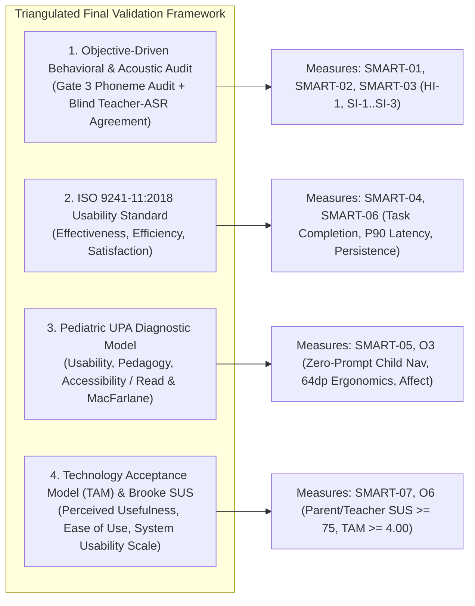

# Final User/Stakeholder Validation Plan and Framework — playIT

**Course & Section:** IT411 (Section G7) — Capstone & Research 2 | Semester 1, AY 2026–2027  
**Group Code / Team:** `2627-sem1-it411-56` — Group 56 (`Riva, Zendrix`; `Palis, John James`; `Miel, Kaysean`; `Durano, Ashlee Skye`; `Bien, Erik Samuel`)  
**Adviser:** Mr. Joemarie C. Amparo | **Course Instructor:** Mr. Ralph P. Laviste  
**Deliverable Reference:** Pre-Adviser Presentation Requirement D (`Final_Validation_Plan_and_Framework`) & Week 12 Deliverable 1 (`01_Validation_Plan_and_Framework`, Due October 31, 2026)  
**System Version Under Test:** `playIT v1.2.0-rc2` (`refactor/hear-say-it` post-Card 32 production build)  

---

## 1. Validation Purpose & Objectives

Unlike the initial **Weeks 1–2 MVP Validation** (which diagnosed early prototype bottlenecks on a baseline build), this **Final User/Stakeholder Validation** evaluates the **completed, refactored, and deployed playIT Android system** (`v1.2.0-rc2`) to determine with empirical evidence whether the system:
1. Effectively addresses the identified early-reading literacy problem for Grade 1 learners (ages 6–7);
2. Meets the functional, pedagogical, and ergonomic needs of its intended end-users (Grade 1 learners) and adult stakeholders (DepEd Grade 1 reading teachers and parents/caregivers); and
3. Achieves every measurable target specified in the group's approved SMART goals (`SMART-01` through `SMART-07` and operational sub-objectives `HI-1`, `HI-2`, `SI-1`–`SI-4`, `O3`–`O6`).

### 1.1 Research Questions (`RQ1`–`RQ5`)

| Research Question ID | Research Question Statement | Linked SMART Goals |
| :--- | :--- | :--- |
| **`RQ1` (Pedagogical & Acoustic Integrity)** | To what extent do playIT's 26 phoneme audio models, 7 articulatory mouth-shape groups, and 33 Marungko-aligned decodable CVC/VVC words satisfy DepEd Grade 1 phonics standards and Gate 3 acoustic purity criteria? | `SMART-01`, `SMART-02`, `HI-1`, `HI-2` |
| **`RQ2` (Speech Recognition & Scaffolding Effectiveness)** | Does the refactored offline Vosk `SpeechValidator` achieve $\ge 80\%$ agreement with blind human teacher ratings and $\le 15\%$ false rejections on Grade 1 child speech within $\le 500\text{ ms}$ while maintaining zero punitive heart loss? | `SMART-03`, `SI-1`, `SI-2`, `SI-3`, `SI-4` |
| **`RQ3` (Child Usability, Discrimination & Blending Mastery)** | Can Grade 1 learners (ages 6–7) independently navigate playIT's onboarding, Bohol adventure map, `Hear It`, `Say It`, `Find It`, and `Blend It` stages ($\ge 85\%$ zero-prompt transitions) and achieve $\ge 2\star$ mastery with positive affect? | `SMART-04`, `SMART-05`, `O3` |
| **`RQ4` (Hardware Performance, Offline Persistence & Privacy)** | Does the deployed APK meet all real-time latency ($\le 500\text{ ms}$ Say It, $\le 300\text{ ms}$ Find It), frame stability ($\le 10\%$ jank at 60 FPS), 20-cycle force-close SQLite persistence, and Airplane-Mode sovereignty requirements on budget hardware (`SM-A217F`)? | `SMART-06`, `O4`, `O5` |
| **`RQ5` (Stakeholder Usability, Diagnostic Utility & Acceptance)** | Do Grade 1 reading teachers and parents/caregivers rate playIT's overall usability at $\text{SUS} \ge 75.0$ and perceived usefulness/ease-of-use at $\text{TAM} \ge 4.00/5.00$, and can they accurately interpret the Parent Zone and exported A4 PDF diagnostic report? | `SMART-07`, `O6` |

---

## 2. Target Respondents & Sampling Justification

To prevent single-source bias and ensure that **child behavioral outcomes** are evaluated separately from **adult diagnostic and pedagogical outcomes**, the validation employs a purposive, multi-stakeholder sample across four cohorts ($N_{\text{total}} = 31\text{–}38$ participants):

| Cohort ID | Respondent Group | Target Sample Size | Inclusion Criteria & Relevance to Intended Users/Stakeholders | Assigned Validation Activities & Instruments |
| :--- | :--- | :--- | :--- | :--- |
| **Cohort 1 (`C-01`..`C-20`)** | **Grade 1 Learners (Primary End-Users)** | **$N = 16\text{–}20$ children** (generating $\ge 150\text{–}240$ logged `Say It` & `Find It` trials) | Enrolled Grade 1 learners aged **6–7 years old** (early/emergent readers). Directly tests whether pre-readers can operate the 64dp interface, articulate phonemes, discriminate letters, and blend CVC words without adult help. | Guided hands-on play session ($15\text{–}20\text{ min}$): Avatar onboarding $\to$ Group 1 letters (`M, S, A`) $\to$ `Blend It` chest; **`Instrument B` (Part B1)** Silent-Observer Sheet; **`Instrument C`** Room DB Telemetry; **`Instrument E` (Part E1)** Child Picture Choice & Smileyometer. |
| **Cohort 2 (`T-01`..`T-05`)** | **DepEd Grade 1 Reading / MTB-MLE & English Teachers (Domain Experts)** | **$N = 4\text{–}5$ teachers** | Licensed elementary educators with $\ge 2\text{ years}$ experience teaching Grade 1 reading/phonics (Marungko / MATATAG curriculum). Qualified to judge phoneme purity (schwa intrusion) and rate child pronunciations blindly. | 1. **`Instrument A`** Blind 26-Phoneme Audit (Gate 3) & 33-Word CVC Audit; 2. **`Instrument B` (Part B2)** Blind Dual-Rater scoring of child `Say It` utterances; 3. **`Instrument E` (Part E2)** Teacher SUS + TAM + Diagnostic Report Evaluation. |
| **Cohort 3 (`P-01`..`P-10`)** | **Parents / Primary Caregivers (Adult Stakeholders)** | **$N = 8\text{–}10$ parents/guardians** | Parents or guardians of Grade 1 children who supervise home reading practice on shared smartphones. Evaluates profile management, the arithmetic gate, progress interpretation, and offline PDF sharing. | Hands-on Parent Zone task walkthrough (unlocking `ArithmeticGuardDialog`, renaming profile, identifying `At-Risk` letters, exporting & opening A4 PDF) + **`Instrument E` (Part E2)** Parent SUS + TAM Survey. |
| **Cohort 4 (`QA-01`..`QA-03`)** | **Technical / QA Evaluators** | **$N = 3$ evaluators** | Capstone technical evaluators executing objective hardware benchmarks and accessibility audits on the physical **Samsung Galaxy A21s (`SM-A217F`)** test device. | **`Instrument D`** (`D-01` to `D-12`): ADB latency/frame/memory benchmarks, 20× force-close persistence in Airplane Mode, 4-viewport bounds check. |

---

## 3. Proposed Validation Model & Theoretical Framework

Our validation architecture integrates four complementary, internationally recognized frameworks so that every SMART goal is evaluated through the right methodological lens:

1. **Objective-Driven Acoustic & Psychometric Agreement Model (Signal Detection / Cohen's $\kappa$):**
   - Evaluates `SMART-02` (`HI-1`) and `SMART-03` (`SI-1`–`SI-3`). Rather than asking adults whether speech recognition "seems accurate" on a questionnaire, two teachers blindly score each child utterance ($T \in \{0, 1\}$), and their consensus is cross-tabulated against the offline Vosk `SpeechValidator` decision ($A \in \{0, 1\}$) to compute exact **Teacher-ASR Agreement ($P_{\text{agree}}$)**, **False-Reject Rate ($P_{\text{FR}}$)**, and **Cohen's/Fleiss' $\kappa$**.
2. **ISO 9241-11:2018 Ergonomics of Human-System Interaction:**
   - **Effectiveness:** Task completion rates across child stages (`Hear It`, `Say It`, `Find It`, `Blend It`) and adult tasks (Parent Gate, PDF Export).
   - **Efficiency:** Objective system response times (`Say It` P90 latency $\le 500\text{ ms}$, `Find It` P90 latency $\le 300\text{ ms}$, lesson completion time in seconds) captured via `Instrument C` and `Instrument D`.
   - **Satisfaction:** Child Smileyometer & voluntary replay rate (`Instrument E` Part E1) and adult **System Usability Scale (SUS)** (`Instrument E` Part E2).
3. **Pediatric UPA (Usability, Pedagogy, Accessibility) Framework & Read & MacFarlane (2006) Child-Computer Interaction Protocol:**
   - Standard Likert surveys are developmentally invalid for 6-to-7-year-old pre-readers. Following Read & MacFarlane (2006), child evaluation relies on **Silent-Observer Behavioral Coding (`Instrument B`)**, a **3-Point Visual Smileyometer**, a **Picture-Card Hardest-Stage Identification**, and a **Behavioral Replay Prompt** (*"Would you like to play one more letter or stop now?"*).
4. **Technology Acceptance Model (TAM — Davis, 1989) & System Usability Scale (SUS — Brooke, 1996):**
   - Administered to Teachers and Parents (`Instrument E` Part E2) to quantify **Perceived Usefulness (PU)**, **Perceived Ease of Use (PEOU)**, **Behavioral Intention (BI)**, and standardized **SUS ($0\text{–}100$)**.

---

## 4. Evaluation Procedures & Step-by-Step Activities

### Phase 1: Pre-Field Gate 3 Teacher Acoustic & Content Audit (`Instrument A`)
1. Prior to child sessions, **3–5 DepEd Grade 1 teachers** independently complete `Instrument A`.
2. In **Part A1 (Blind Phoneme Audit)**, all 26 `audio/phonemes/{letter}.mp3` clips are played in randomized order without showing the letter label. Teachers write the letter sound they hear and rate clarity ($1=\text{Unacceptable / Has schwa}$, $2=\text{Acceptable}$, $3=\text{Model quality}$). All 26 clips must pass before child testing.
3. In **Part A2 & A3**, teachers audit the 33 decodable CVC/VVC words and rate curriculum alignment (`PA1`–`PA5`).

### Phase 2: Hardware, Offline & Accessibility Verification (`Instrument D`)
1. On the physical **Samsung Galaxy A21s (`SM-A217F`, Android 12, 3 GB RAM)** with **Airplane Mode ON** and Wi-Fi/cellular disabled:
   - Execute cold-start timing (`adb shell am start -W`), 60 FPS frame rendering (`dumpsys gfxinfo`), memory profiling (`dumpsys meminfo`), and a 5,000-event `monkey` stress run.
   - Measure 30 trials of `Say It` end-of-speech to feedback latency ($\le 500\text{ ms}$) and 30 trials of `Find It` tap-to-feedback latency ($\le 300\text{ ms}$).
   - Execute the **20-Cycle Force-Close Persistence Test** (`D-05`) and record all 12 engineering checks on `Instrument D`.

### Phase 3: Child End-User Sessions — Silent-Observer Protocol (`Instrument B` & `Instrument E` Part E1)
1. **Ethics & Consent:** Written parental consent and verbal child assent are secured prior to every session. Each learner is assigned an anonymous code (`C-01`..`C-20`); zero names, photos of faces, or raw voice files leave the local session.
2. **Silent-Observer Rule:** The facilitator hands the device (in Airplane Mode) to the child on `SplashScreen` and sits silently beside them. The observer **only** intervenes if the child explicitly asks for help or makes no progress for $\ge 15\text{ seconds}$ (after the app's built-in 10s idle re-prompt has fired), tallying every adult prompt on `Instrument B` (Part B1).
3. **Standard Child Task Scenario ($15\text{–}20\text{ min}$):**
   - **Task C1 (Onboarding):** Tap `Start` on Splash $\to$ tap `+ New Player` $\to$ pick an animal friend avatar $\to$ tap `Let's Play` (0 typing required).
   - **Task C2 (Map & Letter Lesson Loop):** Tap active Node `M` on the Bohol Map $\to$ complete `Hear It` (3 audio steps) $\to$ complete `Say It` (spoken echo + recall check) $\to$ complete `Find It` (3 picture-grid rounds) $\to$ view `LetterCompleteScreen` stars.
   - **Task C3 (Subsequent Letters & Blend It):** Complete Letters `S` and `A` (or transition to an unlocked Group 1 `Blend It` treasure chest) and blend 3 decodable CVC words (`AM`, `SAM`, `MAT`).
4. **Live/Recorded Teacher Rating of `Say It` Trials (`Instrument B` Part B2):** For each `Say It` attempt, two teachers independently mark whether the child produced the valid target sound/word ($T=1$) or an invalid foil/silence ($T=0$), logged alongside the app's `SpeechValidator` outcome ($A \in \{0, 1\}$).
5. **Post-Session Child Exit Check (`Instrument E` Part E1):** The child points to the **Smileyometer** face, points to which of the 4 game picture cards felt hardest, and responds to the voluntary replay prompt (*"You're done! Would you like to play one more letter, or stop now?"*).

### Phase 4: Parent & Teacher Diagnostic Walkthrough (`Instrument E` Part E2)
1. Parents (`P-01`..`P-10`) and Teachers (`T-01`..`T-05`) perform four concrete adult tasks on the device populated with session data:
   - **Task A1:** Open `Parent Zone` and solve the randomized `ArithmeticGuardDialog` challenge.
   - **Task A2:** Rename a learner's profile in `LearnerHeroCard` and switch between learner profiles.
   - **Task A3:** Inspect `MasteredSoundsShelf` and `PracticeFocusSection` to correctly name which letters are flagged as **Mastered (`Green`)**, **Developing (`Yellow`)**, or **At-Risk (`Red/Amber`)**.
   - **Task A4:** Tap **PDF**, preview the generated report on `ReportPreviewScreen`, and open the offline A4 PDF document.
2. Immediately after completing Tasks A1–A4, adult participants complete **Instrument E (Part E2)** (10-item Brooke SUS + 10-item TAM & Diagnostic Utility scale + 3 open-ended diagnostic prompts).

---

## 5. Statistical Analysis Methods & Decision Rules

| Metric Category | Statistical Estimator / Calculation Formula | Acceptance / Success Criterion |
| :--- | :--- | :--- |
| **Binomial Proportions** *(Task completion, Zero-prompt navigation, Teacher-ASR agreement, False-reject rate)* | Point estimate $\hat{p} = \frac{k}{n}$ with **Wilson 95% Confidence Interval**: $$\frac{\hat{p} + \frac{z^2}{2n} \pm z\sqrt{\frac{\hat{p}(1-\hat{p})}{n} + \frac{z^2}{4n^2}}}{1 + \frac{z^2}{n}}, \quad z = 1.96$$ | $\hat{p}_{\text{nav}} \ge 85.0\%$; $\hat{p}_{\text{agree}} \ge 80.0\%$; $\hat{p}_{\text{FR}} \le 15.0\%$. |
| **Inter-Rater Reliability** *(Dual-teacher scoring of child `Say It` attempts)* | **Cohen's Kappa ($\kappa$)** (2 raters) or **Fleiss' Kappa** ($\ge 3$ raters): $$\kappa = \frac{P_o - P_e}{1 - P_e}$$ | $\kappa \ge 0.70$ (substantial inter-rater agreement). |
| **Response Time & Latency Distributions** *(`Say It` & `Find It` latency, Cold start)* | Median (**P50**), **90th Percentile (P90)**, Mean, Standard Deviation (SD), and Min–Max range in milliseconds. | **Say It P90 $\le 500\text{ ms}$**; **Find It P90 $\le 300\text{ ms}$**; **Cold Start $\le 2500\text{ ms}$**. |
| **System Usability Scale (SUS)** *(Brooke, 1996 — 10 items)* | Odd items: $x_i - 1$; Even items: $5 - x_i$: $$\text{SUS} = 2.5 \times \left(\sum_{\text{odd}} (x_i - 1) + \sum_{\text{even}} (5 - x_i)\right) \in [0, 100]$$ | **Mean SUS $\ge 75.0$** (Bangor et al. "Good" to "Excellent" adjective rating). |
| **TAM & Pedagogical Likert Constructs** *(5-point Likert items)* | Construct Mean $\bar{x} = \frac{1}{N}\sum x_i$ and Standard Deviation $s$:<ul><li>$4.21\text{–}5.00$: Strongly Agree / Highly Effective</li><li>$3.41\text{–}4.20$: Agree / Effective</li><li>$< 3.41$: Needs Improvement</li></ul> | **Mean $\ge 4.00 / 5.00$** across Perceived Usefulness (PU), Perceived Ease of Use (PEOU), and Pedagogical Alignment (PA). |
