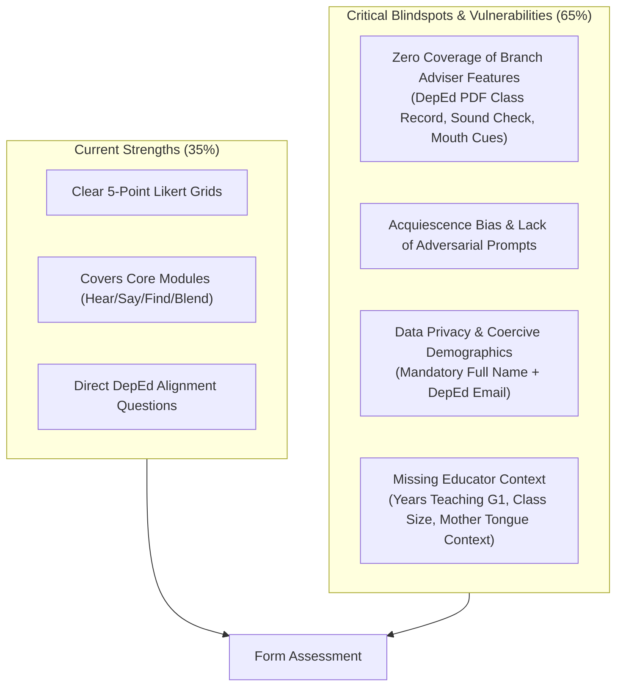
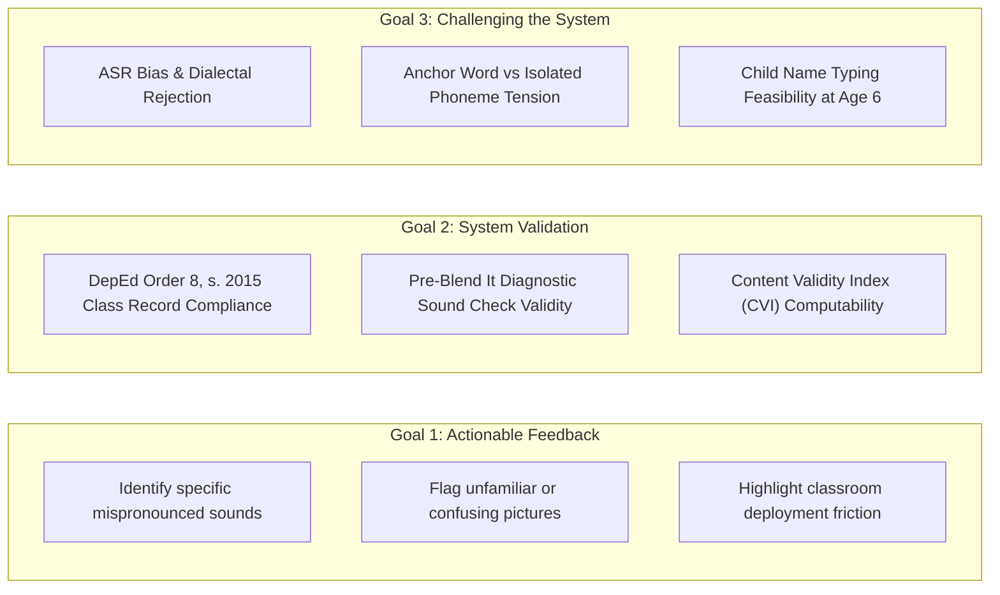
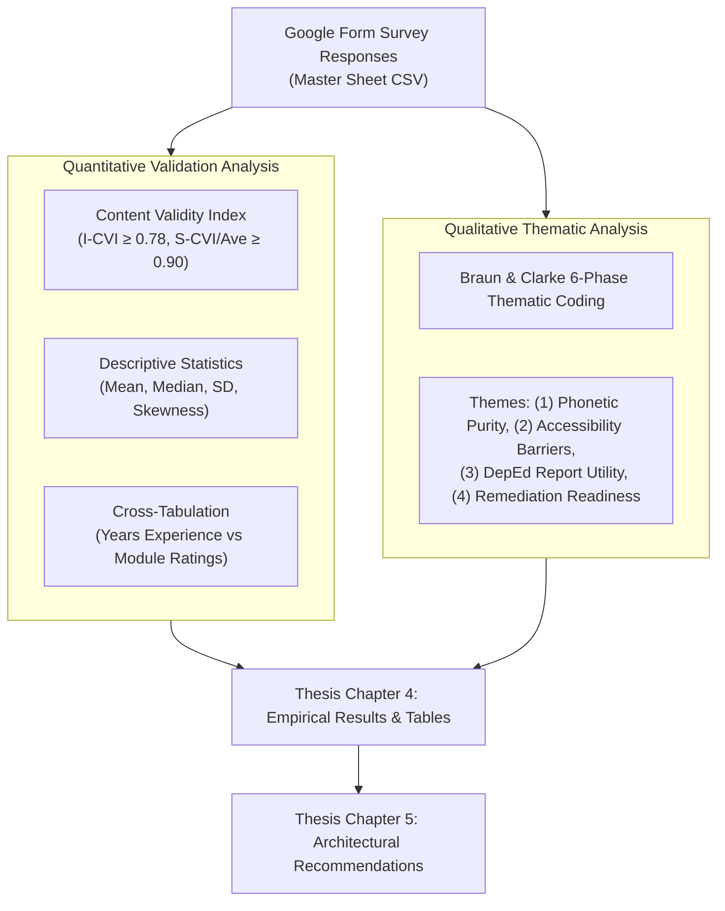

# Comprehensive Evaluation & Enhancement Plan: PlayIT Teacher Evaluation Instrument
**Document Type:** Research & Academic Evaluation Report  
**Course:** IT411 — Capstone Project & Research 2 | Semester 1, AY 2026–2027  
**Project:** PlayIT: An Offline-First Gamified Early Literacy Mobile Application Using the DepEd Marungko Approach  
**Evaluated Artifact:** Google Form Instrument (`PlayIT - TeacherEvaluation` — [forms.gle/PZ5kBNxUojhfdCLM6](https://forms.gle/PZ5kBNxUojhfdCLM6))  
**Target Active Git Branch:** `enhance/adviser-feedback`  
**Date of Audit:** November 8, 2026  

---

## 1. Executive Summary & Audit Verdict

This audit evaluates the newly deployed teacher feedback form ([forms.gle/PZ5kBNxUojhfdCLM6](https://forms.gle/PZ5kBNxUojhfdCLM6)) against the user's primary objectives: **(1) to gather actionable feedback for improvement from DepEd reading teachers**, and **(2) to validate and rigorously challenge the system** under the newly implemented enhancements on the `enhance/adviser-feedback` branch.

### Overall Verdict: **Partially Effective (6.5 / 10) — Good Foundational Draft, Significant Gaps in Challenging the System and Capturing Recent Adviser Enhancements**



### Key Audit Findings:
1. **Major Feature Blindspot (The `enhance/adviser-feedback` Gap):**  
   The current form was drafted against earlier MVP concepts and completely overlooks the substantial architectural and pedagogical features added on `enhance/adviser-feedback`:
   - **DepEd Order 8, s. 2015 Transmutation & Class Record PDF:** The app now transmutes gameplay scores into official DepEd grades (60% = 75, Outstanding, Very Satisfactory, etc.) and generates a landscape A4 printable class record for teachers. Teachers are the **only** stakeholders qualified to validate this, yet the form does not ask a single question about it.
   - **Diagnostic Sound Check:** The pre-Blend It diagnostic letter-sound checkpoint (testing letter-sound mastery before word building, conceived directly from teacher feedback) is entirely unmeasured.
   - **Visual Articulation Mouth Shapes (NFR-ACC-01):** The enlarged, voice-pulsing mouth animation that models lip/teeth positioning on phonetic pronunciation is absent.
   - **Scaffolded Word-Label Fading in Find It:** Progressive removal of text labels (Chapter 1 all words, Chapter 2 partial, Chapter 3 pictures only) is unassessed.
2. **Social Desirability & Acquiescence Bias:**  
   The form makes both **Full Name** and **DepEd Email Address** mandatory. In Philippine basic education culture, identifying public school teachers alongside their institutional email when critiquing software creates acute social desirability bias; teachers will overwhelmingly select "Agree" or "Strongly Agree" to avoid professional friction or offending the researchers.
3. **Passive Validation vs. Active Challenge:**  
   The questions are almost uniformly phrased in the positive ("The app supports...", "The order supports...", "The feedback is encouraging..."). To truly *challenge* the system, the instrument must include adversarial questions and targeted stress-tests (e.g., dialectal speech variations, failure modes in noisy classrooms, phonetic isolation vs. anchor word recall, heart-loss frustration).

---

## 2. Detailed Item-by-Item Diagnostic Matrix

Below is a systematic audit of all 12 items currently present in the Google Form:

| Item # | Current Title / Prompt | Type & Sub-Items | Pedagogical & Research Validity Assessment | Vulnerabilities & Limitations | Concrete Recommendation |
|:---:|---|---|---|---|---|
| **1** | Full name | Text (Required) | **Low** | Violates standard research ethics guidelines (RA 10173 Data Privacy Act). Causes hesitation in offering harsh, critical feedback. | Change to **Optional**, or use an anonymized Teacher Participant Code (e.g., `T-01`, `T-02`). |
| **2** | DepEd email address (`name@deped.gov.ph`) | Text (Required) | **Low** | Highly coercive for state-employed teachers. DepEd email implies official institutional oversight, chilling open criticism. | Change to **Optional** (only for follow-up interview consent). |
| **3 & 4** | **Curriculum** | Grid (5-pt Likert + N/A, Required):<br>1. Aligns with DepEd G1 competencies<br>2. Sequence follows Marungko<br>3. Difficulty appropriate for G1 | **Moderate-High** | Covers statutory curriculum alignment. However, it does not specify whether Marungko is being adapted for **English** phonics or Mother Tongue, which often confuses DepEd teachers who know Marungko primarily as a Filipino/Tagalog tool. | Clarify in the section description that PlayIT adapts the Marungko frequency sequence specifically for **English phonics**. Add an item on excluding `ng` and `ñ`. |
| **5 & 6** | **Modules and learning sequence** | Grid (5-pt Likert + N/A, Required):<br>8 sub-statements covering Map, Hear, Say, Find, Blend, and Activity Order | **Moderate** | Good module-by-module breadcrumb. However:<br>- Item 6.1 ("learning map and unlocking... support mastery") is double-barreled.<br>- Item 6.3 ("asking the child to say a whole word is suitable") touches the core Vosk compromise but doesn't probe whether whole words undermine phoneme isolation. | Split double-barreled statements. Add a direct probe: *"Does saying an anchor word (e.g., 'mouse') help or hinder the child in isolating the initial sound /m/?"* |
| **7** | Any concern about any module? | Long Text (Optional) | **Moderate** | A generic "any concern" catch-all often results in blank submissions or polite "None" remarks. | Provide structured prompt anchors: *"Did any letter sound, speech prompt, picture, or word challenge or confuse the learner?"* |
| **8 & 9** | **Feedback and content** | Grid (5-pt Likert + N/A, Required):<br>5 sub-statements: immediate feedback, error correction, encouragement, familiar images, appropriate language | **Moderate-High** | Good coverage of constructivist feedback and cultural relevance. However, it misses the **gamification consequence** (heart depletion and star thresholds). | Add an item evaluating whether heart-depletion causes learner discouragement or promotes resilience. |
| **10 & 11** | **Overall** | Grid (5-pt Likert + N/A, Required):<br>1. Supports early literacy<br>2. Supplementary tool in G1 | **Moderate** | Standard summative acceptance items (TAM Perceived Usefulness). Highly prone to ceiling effects (everyone rates 4 or 5). | Complement with specific deployment mode queries (e.g., *"Best suited for: [ ] Remedial reading / Catch-up Fridays [ ] Independent home practice [ ] Whole-class instruction"*). |
| **12** | What should be changed, added or removed? | Long Text (Optional) | **Moderate** | Standard ending question. Too broad to force critical reflection on missing competencies. | Break into two explicit prompts: (1) Pedagogical flaws/missing skills, and (2) Specific words or pictures to replace. |

---

## 3. The Three Strategic Gaps: How to Truly Validate & Challenge the System



### 3.1 Gap 1: Validating the `enhance/adviser-feedback` Advancements

The active development branch (`enhance/adviser-feedback`) reflects intensive iterations driven by the thesis adviser and initial teacher consultations. The current form is **blind** to these changes:

1. **DepEd Order 8, s. 2015 Grading Transmutation & Class Record PDF:**
   - *Current Implementation:* Letters are scored based on first-attempt accuracy in Say It and Find It, transmuted using DepEd's statutory 60% = 75 threshold, categorized into official descriptors (*Outstanding*, *Very Satisfactory*, *Satisfactory*, *Fairly Satisfactory*, *Did Not Meet Expectations*), and formatted into a printable landscape A4 PDF report with school header and facilitator notes.
   - *Evaluation Need:* The form **must** ask teachers:
     - *"Does the app’s progress reporting and PDF class record format align with DepEd grading standards (DepEd Order 8, s. 2015)?"*
     - *"Are the progress descriptors and 'Practice at home' recommendations clear and useful for parent-teacher conferences?"*
2. **The Pre-Blend It Diagnostic Sound Check:**
   - *Current Implementation:* Before entering the Blend It word game, the child undergoes a 4-sound diagnostic checkpoint (*"Which letter says /m/?"*). Tracks first attempt and latest attempt across days.
   - *Evaluation Need:* Teachers must evaluate:
     - *"Is a 4-sound diagnostic check before word blending an effective indicator of blending readiness?"*
3. **Mouth Articulation Visualizer (NFR-ACC-01):**
   - *Current Implementation:* On the second miss in Say It (or upon tapping the magnifier), an enlarged mouth shape pulses with Lily's voice to demonstrate lip and tongue placement.
   - *Evaluation Need:*
     - *"Do the visual mouth-shape cues effectively support children in articulating unfamiliar English phonemes?"*
4. **Scaffolding Word Labels in Find It:**
   - *Current Implementation:* Chapter 1 displays words on all cards; Chapter 2 displays words on 2 of 5 cards; Chapter 3+ hides words completely, showing only pictures.
   - *Evaluation Need:*
     - *"Does gradually fading word labels across chapters effectively prevent guessing and encourage phonetic decoding?"*

---

### 3.2 Gap 2: Truly "Challenging" the System (Adversarial Testing)

To avoid a rubber-stamp evaluation where every teacher simply clicks "Agree", the form must present **challenging pedagogical and technical scenarios**:

1. **The Phoneme Isolation vs. Anchor Word Dilemma:**
   - *The System Reality:* Vosk speech recognition cannot reliably detect isolated consonant bursts (/m/, /s/, /t/) without high false-positive noise triggers. Therefore, PlayIT asks the child to say the key word (*"mouse"*, *"sun"*, *"tiger"*).
   - *The Challenge Question:* Ask teachers directly:
     - *"In Say It, the app assesses initial sounds by asking learners to say the anchor word (e.g., 'Say mouse' for /m/). In your teaching experience, does this risk children memorizing the word rather than producing the pure phoneme sound?"*
2. **Offline ASR Strictness vs. Dialectal Inclusion:**
   - *The System Reality:* The app implements decoy phoneme filtering (e.g., rejecting *"onsect"* for *"insect"*, *"house"* for *"mouse"*). In Philippine regional classrooms, phonological interference (e.g., /i/ vs /e/, /b/ vs /v/, /p/ vs /f/) is common.
   - *The Challenge Question:*
     - *"How forgiving should speech recognition be of Philippine regional accent variations in Grade 1 early English learners?"*
     - Options: *Very strict (phonetic purity) | Moderately forgiving (intelligibility first) | Very lenient (encouragement over accuracy)*.
3. **Cognitive Feasibility of Name Typing for 5–7 Year Olds:**
   - *The System Reality:* The latest commit on `enhance/adviser-feedback` replaced avatar-only onboarding with a mandatory on-screen keyboard name typing step (*"Now type your name!"*).
   - *The Challenge Question:*
     - *"Can beginning Grade 1 learners in public schools independently type their name on a mobile virtual keyboard without adult assistance?"*
4. **Gamification & Frustration Thresholds:**
   - *The Challenge Question:*
     - *"Does depleting hearts (retries) cause undue frustration or discouragement for struggling beginning readers?"*

---

### 3.3 Gap 3: Methodological & Demographic Rigor (For Thesis Chapter 4)

To defend the validation results in IT411 Capstone defense, the instrument must satisfy academic rigor:

1. **Teacher Demographic Profiling:**
   - Current grade taught (Kindergarten, Grade 1, Grade 2, Reading Coordinator / Master Teacher).
   - Years teaching early reading (1–3 years, 4–7 years, 8–15 years, 16+ years).
   - School type (DepEd Central Public, DepEd Non-Central/Barrio, Private School, Community Learning Center).
   - Dominant Mother Tongue of their learners (Cebuano, Tagalog, Ilocano, Hiligaynon, etc.).
2. **Content Validity Index (CVI) Compatibility:**
   - Items should be structured on a standard 4-point or 5-point ordinal scale (1 = Not Relevant/Strongly Disagree to 4/5 = Highly Relevant/Strongly Agree) to allow computing **I-CVI (Item-level Content Validity Index)** and **S-CVI (Scale-level Content Validity Index)** as formal evidence in Chapter 4.
3. **Data Privacy Compliance (RA 10173):**
   - Provide an explicit informed consent toggle.
   - Make Name and Email **explicitly optional**, explaining that data is coded anonymously (`T-01`, `T-02`) in published reports.

---

## 4. The Recommended Redesigned Instrument Specification

Below is the complete, production-ready specification for the enhanced Google Form, ready to be deployed or updated in Google Forms.

```
FORM TITLE: PlayIT: DepEd Teacher Validation & Pedagogical Evaluation
FORM HEADER: Formative System Evaluation — DepEd Reading Teachers & Early Literacy SMEs
```

### Form Description & Consent
```markdown
Thank you for evaluating PlayIT, an offline-first Android mobile application designed to teach 
English phonics to Grade 1 Filipino learners using the DepEd Marungko Approach.

PlayIT teaches 26 English letter sounds across 7 sequential chapters through:
1. Hear It (clear phonetic sound modeling + animated mouth-shape articulation cues)
2. Say It (offline voice practice with speech recognition)
3. Find It (picture discrimination with progressive word-label scaffolding)
4. Blend It (word construction preceded by a diagnostic Sound Check)
5. Parent/Teacher Dashboard (DepEd Order 8, s. 2015 class record progress & PDF export)

Your expert evaluation will directly validate our software and challenge our pedagogical choices 
for our Capstone Research (IT411). Responses are strictly confidential and governed by the Data 
Privacy Act of 2012 (RA 10173). Evaluators are reported anonymously as coded participants (e.g., T-01).
```

---

### Section 1: Informed Consent & Educator Profile

* **Q1. Informed Consent** `[Single Choice, Required]`
  - [ ] Yes, I freely consent to evaluate PlayIT and have my anonymized feedback included in academic research.
  - [ ] No, I decline. *(Terminates form)*
* **Q2. Current Teaching Role / Specialization** `[Single Choice, Required]`
  - [ ] DepEd Grade 1 Classroom Teacher
  - [ ] Kindergarten Teacher
  - [ ] Reading Specialist / Remedial Reading Teacher
  - [ ] Master Teacher / Head Teacher / Curriculum Coordinator
  - [ ] Private School Early Childhood / Primary Educator
* **Q3. Years of Experience Teaching Early Reading / Phonics** `[Single Choice, Required]`
  - [ ] 1–3 years
  - [ ] 4–7 years
  - [ ] 8–15 years
  - [ ] 16+ years
* **Q4. School Classification & Region / Division** `[Short Text, Required]`
  - *(e.g., Public Central School, Cebu City Division)*
* **Q5. Primary Mother Tongue of Your Learners (MTB-MLE Context)** `[Single Choice, Required]`
  - [ ] Cebuano / Sinugbuanon
  - [ ] Tagalog / Filipino
  - [ ] Ilocano
  - [ ] Hiligaynon
  - [ ] Waray
  - [ ] Other: `[Short Text]`
* **Q6. Name of Evaluator (Optional — for formal thesis panel acknowledgement)** `[Short Text, Optional]`
* **Q7. DepEd Email Address (Optional — if willing to be contacted for brief follow-up)** `[Short Text, Optional]`

---

### Section 2: Curriculum Alignment & Marungko Sequence

*Rate each statement on a 5-point scale: (1) Strongly Disagree, (2) Disagree, (3) Neutral, (4) Agree, (5) Strongly Agree, (N/A) Not Applicable.* `[Multiple Choice Grid, Required]`
1. **[CUR-01]** The letter sequence (starting with m, s, a, i, o, b...) is appropriate for teaching English phonics to Filipino Grade 1 learners.
2. **[CUR-02]** Excluding Filipino digraphs (`NG`) and graphemes (`Ñ`) to focus strictly on the 26 English alphabet letters is pedagogically sound for an English phonics app.
3. **[CUR-03]** The 4-letter chapter pacing (introducing 4 letters before requiring word blending) provides adequate scaffolding for beginning readers.
4. **[CUR-04]** The vocabulary words used throughout the app are familiar, culturally appropriate, and non-confusing for Filipino children.

---

### Section 3: Learning Modules & Instructional Mechanics

*Rate each statement on the 5-point scale.* `[Multiple Choice Grid, Required]`
1. **[MOD-01] Hear It:** The letter sounds are pronounced accurately as pure phonemes without unwanted trailing vowels or letter names (e.g., held /m/ as "mmm", not "ma").
2. **[MOD-02] Articulation Modeling:** The enlarged, voice-pulsing mouth shapes provide effective visual cues for children struggling to produce unfamiliar English sounds.
3. **[MOD-03] Say It (Speech Practice):** Asking the child to say the anchor word (e.g., "mouse" for /m/) is an effective and realistic way to practice initial letter sounds.
4. **[MOD-04] Speech Fairness:** The speech recognition responds fairly to children's natural voices and regional accents without excessive false rejections.
5. **[MOD-05] Find It (Scaffolding):** Showing word labels in Chapter 1 and gradually removing them in later chapters effectively reinforces phonetic recognition rather than sight guessing.
6. **[MOD-06] Diagnostic Sound Check:** Administering a quick 4-sound identification check before unlocking Blend It is an effective checkpoint for blending readiness.
7. **[MOD-07] Blend It (Word Synthesis):** Assembling 3-letter CVC words from letters already mastered supports early blending and decodability.

---

### Section 4: DepEd Progress Reporting & Classroom Feasibility

*Rate each statement on the 5-point scale.* `[Multiple Choice Grid, Required]`
1. **[REP-01] DepEd Order 8, s. 2015 Alignment:** The app's progress levels (Outstanding, Very Satisfactory, Satisfactory, Did Not Meet Expectations) and transmuted grades (60% = 75) accurately reflect DepEd classroom assessment standards.
2. **[REP-02] Teacher Class Record (PDF):** The downloadable landscape A4 Class Report provides actionable diagnostic data suitable for teacher monitoring and parent consultations.
3. **[REP-03] Independent Use:** The audio narration, clear visual buttons, and mascot guidance allow a Grade 1 learner to practice independently with minimal teacher intervention.
4. **[REP-04] Gamification Balance:** The 3-heart retry system and star rewards encourage perseverance without causing frustration when errors occur.

---

### Section 5: Challenging the System (Critical SME Reflection)

* **Q8. Phoneme vs. Whole Word Production:**  
  *PlayIT uses whole anchor words (e.g., "mouse" for /m/, "sun" for /s/) for speech recognition because offline engines struggle with short isolated consonant bursts. In your expert opinion, does this practice support or hinder pure phonemic awareness? How would you improve it?*  
  `[Long Text, Required]`
* **Q9. Regional Accents & Speech Strictness:**  
  *Grade 1 Filipino learners often interchange certain sounds based on their regional mother tongue (e.g., /p/ and /f/, /b/ and /v/, short /i/ and long /i/). How strict should the speech recognition be?*  
  - [ ] Strict: Require standard English phonetic accuracy; reject regional phonetic substitutions.
  - [ ] Balanced: Allow minor regional vowel/consonant shifts as long as the core word is recognizable.
  - [ ] Lenient: Focus primarily on vocal effort and engagement; avoid rejecting developing speech.
  - Comments / Nuance: `[Short Text]`
* **Q10. Name Typing vs. Avatar Selection:**  
  *The app asks new learners to type their first name on an on-screen keyboard. Do your Grade 1 learners have sufficient digital literacy to do this independently, or will this become a barrier in the classroom?*  
  `[Long Text, Required]`
* **Q11. Specific Problematic Content:**  
  *Were there any specific letter sounds, images, or vocabulary words that you believe need immediate correction or replacement? (Please name the letter/word and why).*  
  `[Long Text, Optional]`
* **Q12. DepEd Catch-up Fridays & Remediation Integration:**  
  *How could you see PlayIT being deployed in your school (e.g., Catch-up Fridays, remedial reading clinics, offline computer laboratory, home supplement)? What missing feature is holding it back?*  
  `[Long Text, Required]`

---

## 5. Mapping Responses to Thesis Chapter 4 (Results & Discussion)

To demonstrate how updating this form directly supports the academic defense, the following quantitative and qualitative analytical pipeline will be applied to the collected data:



### 5.1 Content Validity Index (CVI) Formula for Chapter 4
For each item in Sections 2, 3, and 4, teacher ratings of 4 ("Agree") and 5 ("Strongly Agree") will be counted as endorsements ($n_A$):

$$\text{I-CVI} = \frac{n_A}{N}$$

- **Target I-CVI:** $\ge 0.78$ with 4 or more experts (Polit & Beck, 2006).
- **Scale-Level Content Validity (S-CVI/Ave):** Mean of all I-CVIs, with a target of $\ge 0.90$.
- Any item scoring below $0.78$ immediately triggers an architectural fix card on the development board.

---

## 6. Actionable Implementation Plan for the Research Team

To immediately elevate the instrument while keeping the live link functional:
1. **Update Form Settings in Google Forms:**
   - Change Item 1 (Full name) and Item 2 (Email) to **Optional**.
   - Add the Informed Consent statement as a mandatory first question.
   - Insert the teacher demographic fields (Role, Experience, School, Mother tongue).
2. **Add the Missing Adviser Evaluation Items:**
   - Add the specific items for **DepEd Order 8 s. 2015 class record / PDF export**, the **pre-Blend It Sound Check**, and the **articulation mouth cues**.
3. **Update the Critical Open-Ended Questions:**
   - Replace generic "any concerns" with the targeted adversarial questions on **Vosk speech recognition fairness**, **anchor word vs phoneme**, and **name typing feasibility**.
4. **Synchronize Repository Documentation:**
   - Update `docs/validation-package/02_GOOGLE_FORM_INSTRUMENT_SPECIFICATION.md` to reflect these improvements as Version 2.0.
   - Maintain the live Google Form URL: `https://forms.gle/PZ5kBNxUojhfdCLM6`.
